# MeetingBot · AI 智能会议纪要辅助系统

把一场会议的录音、视频或资料变成一份**可确认、可导出**的结构化纪要：

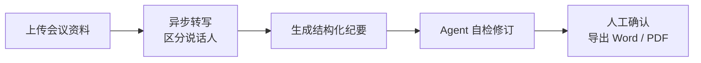

> 本仓库是 AIMeeting 的工程化重建主线：保留原项目的业务链路与设计取舍，
> 补齐部署、鉴权、日志与测试。界面与 MeetingBot 主分支共用同一套设计语言
> （浅灰底 + 白色卡片 + 品牌蓝 `#2563eb` + 圆角胶囊菜单，logo / favicon 同源）。
> 部署与运维细节见 [DEPLOYMENT.md](DEPLOYMENT.md)，架构与工作流分析见
> [`架构图/`](架构图/AI会议纪要助手-架构与工作流分析.md)。

## 界面预览

> 下面全部是本机真实部署的截图（`meetingbot-aim-local`，1600×1000，真实演示数据，非设计稿）。

| 登录 | 系统首页 |
| --- | --- |
| 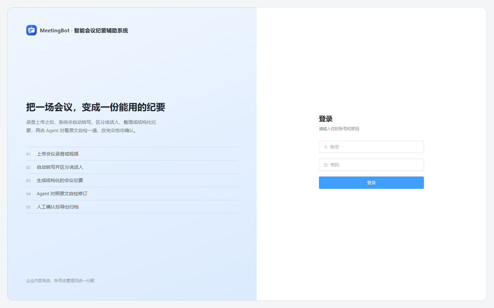 | 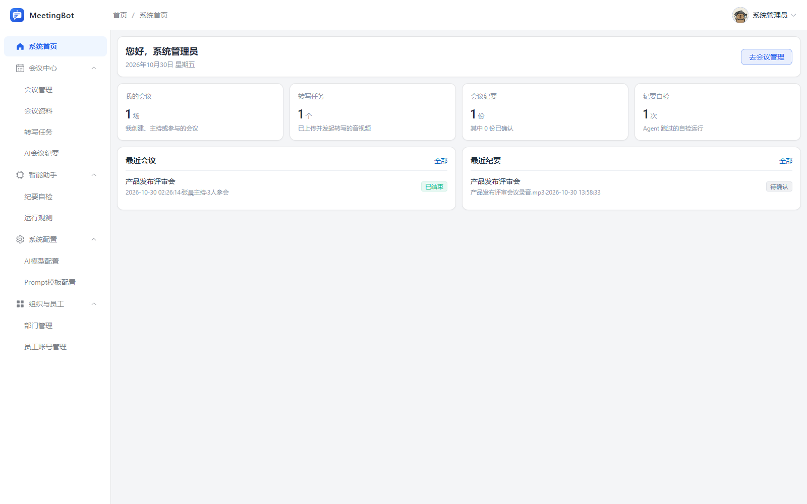 |
| **会议管理** | **会议资料（上传 / 去重 / 预览）** |
| 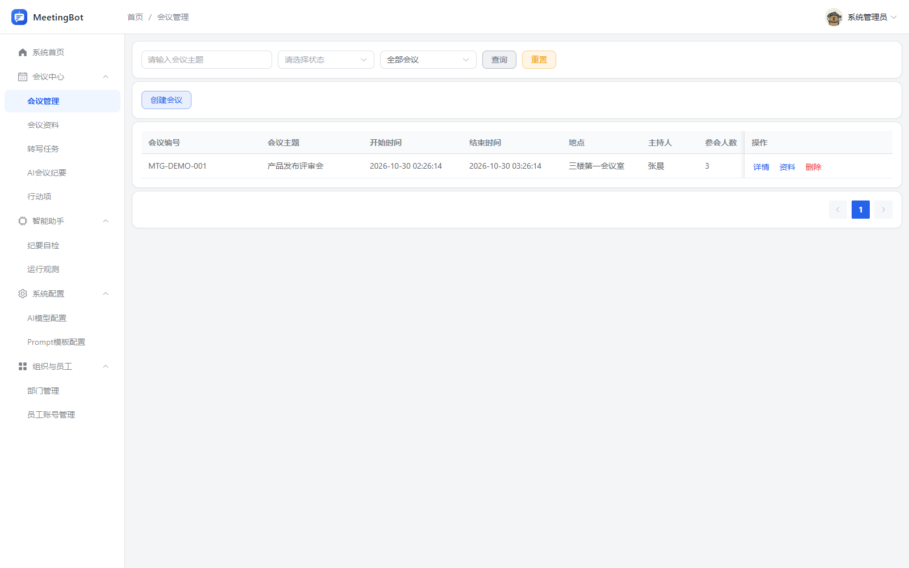 | 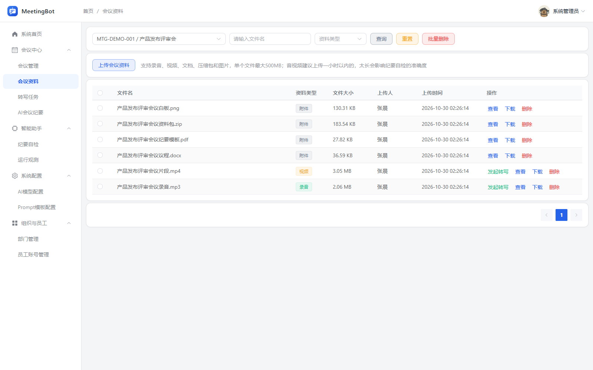 |
| **转写任务** | **转写详情（时间轴 + 说话人匹配）** |
| 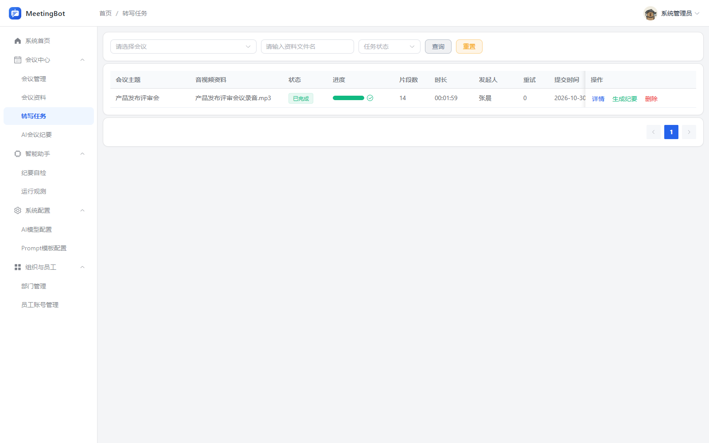 | 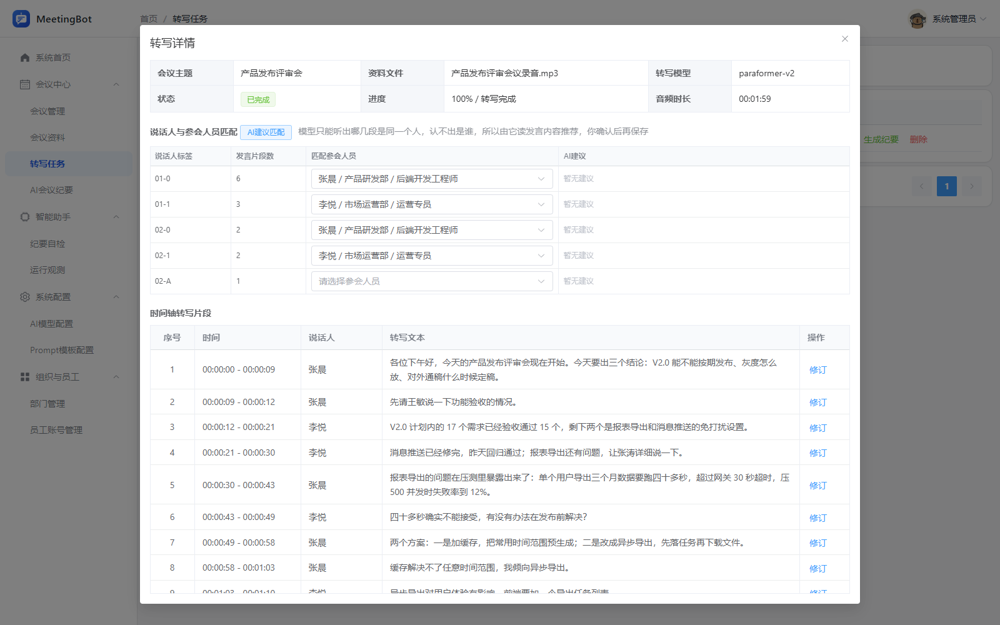 |
| **AI 会议纪要** | **纪要详情（六块结构化内容）** |
| 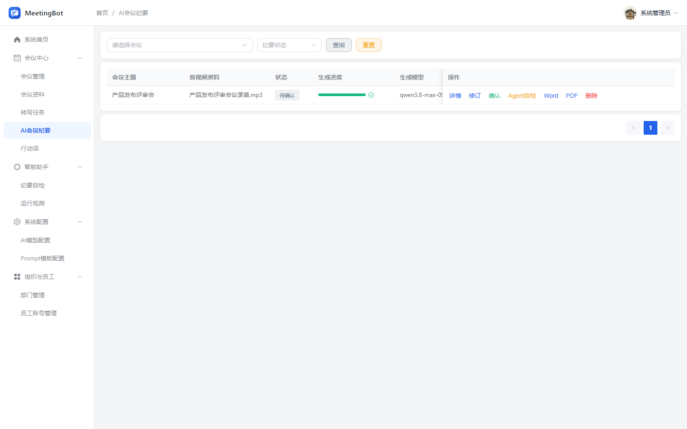 | 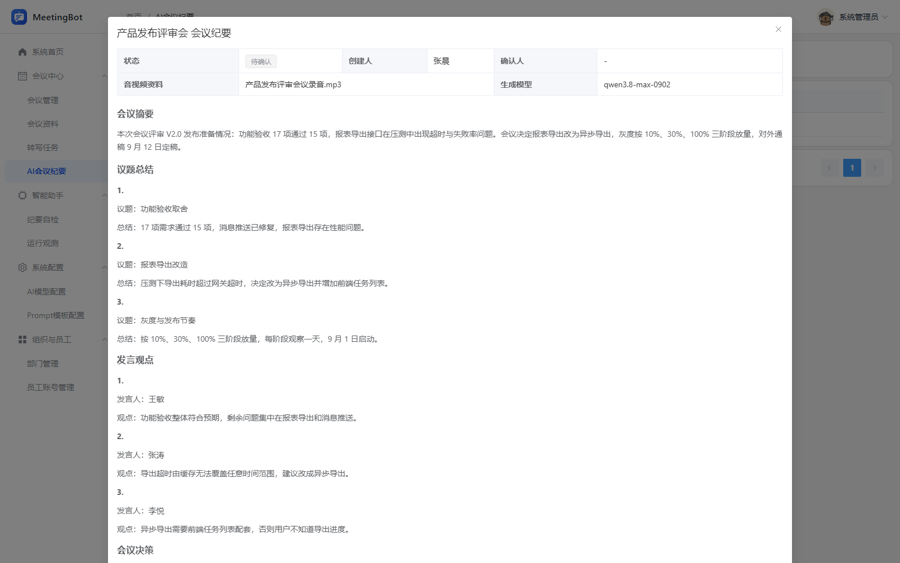 |
| **Agent 自检** | **自检详情（反思环时间线 + 人工确认）** |
| 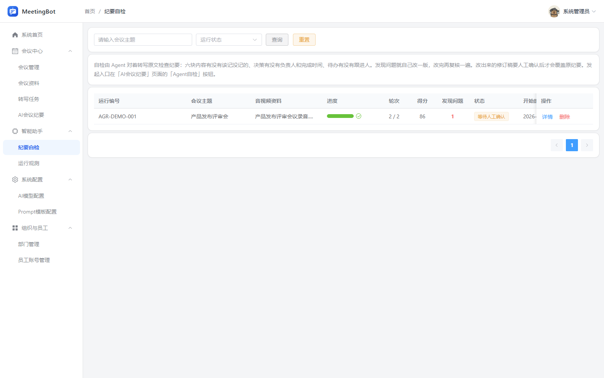 | 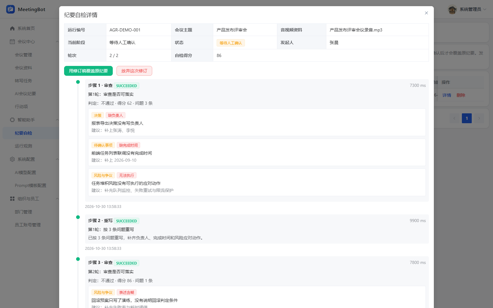 |
| **运行观测（调用/Token/失败）** | **AI 模型配置** |
| 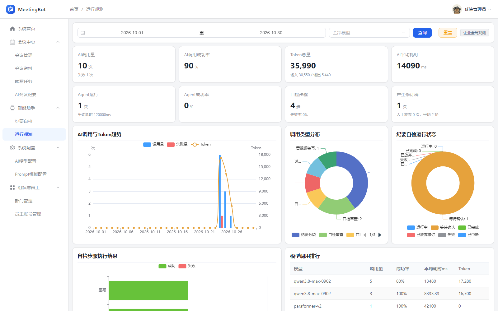 | 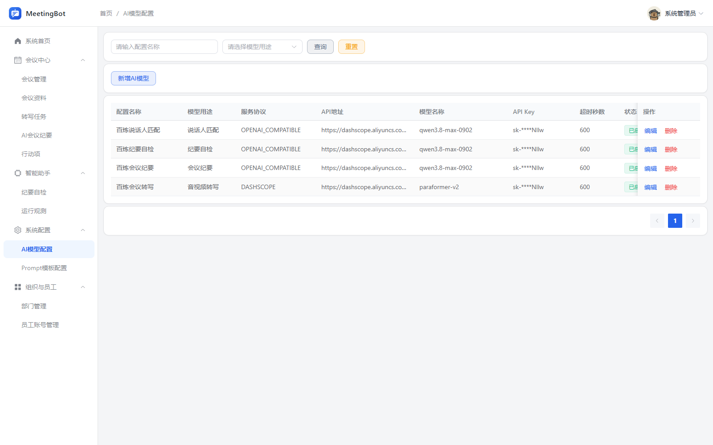 |

组织与员工、个人资料、Prompt 模板配置页面截图同样收录在
[`docs/screenshots/`](docs/screenshots/) 目录。

## 这个项目是什么

企业内部使用的「会议录音 → 结构化纪要」辅助系统，由两部分组成：

- **后端** `meetingbot/fastapi-app/`：FastAPI + Tortoise ORM + MySQL 8.4，
  负责认证、会议与资料管理、异步转写、纪要生成、Agent 自检与运行观测；
- **前端** `meetingbot/vue/`：Vue 3 + Element Plus 管理端 SPA，
  生产环境由 nginx 托管静态资源，并把 `/api/`、`/files/` 反代到后端（同源部署）。

整个项目围绕一条根约束设计：**模型是链路上唯一既慢、又可能漏、又可能编造，且无法被工程手段消除不确定性的环节**。
所以工程量主要花在给模型加边界（分片、强 Schema、自检、人工确认、全量埋点）上，
而不是让 Prompt 更聪明：**模型只做建议，产物必须人工确认后才写回业务数据**。

## 五步工作流

### 01 上传会议资料

在会议下上传录音、视频或附件（单文件 ≤ 500 MB）；后端按 SHA-256 去重，
按扩展名分类为 AUDIO / VIDEO / ATTACHMENT，支持在线预览与下载。

### 02 转写并区分说话人

对音视频「发起转写」后，后台异步任务把文件用 FFmpeg 切成固定时长的分片，
逐片调百炼录音文件识别，再重建时间轴与说话人标签；页面轮询进度。
转写片段可人工修订错字，说话人可手动匹配或让模型给出建议、由人采纳。

### 03 生成结构化纪要

把转写文本按字符数分块（map）提取后合并（reduce），产出六块强 Schema 内容：
`summary` 摘要、`topics` 议题、`viewpoints` 发言观点、`decisions` 决策、
`pending_items` 待确认事项、`risks` 风险与争议。草稿可在线修订。

### 04 Agent 自检修订

LangGraph 反思环：`review`（对照转写原文审查）→ `refine`（按问题重写）→
`finalize`（汇总结论），轮数有上限；页面经 SSE 实时看到时间线。
模型改出的修订稿只落在运行记录里，**不会直接覆盖纪要**。

### 05 人工确认与导出

人决定「应用修订稿 / 放弃」；纪要确认归档后导出 Word / PDF；
运行观测页可复盘每次模型调用的状态、耗时与失败原因。

## 功能与接口概览

统一约定：

- 所有业务接口返回 `Result{code, msg, data}`，HTTP 状态码恒为 200，
  `code` 取 `200`（成功）/ `401`（登录失效）/ `403`（无权限）/ `500`（业务失败）；
- 认证使用自定义 `token` 请求头（JWT），每个请求都回查 `user` 表，
  账号停用后旧 Token 立即失效；
- 数据边界 = 会议访问权（管理员 / 创建人 / 主持人 / 参会人），
  管理员接口额外要求 `ADMIN` 角色；
- 健康检查：`GET /health`（后端 9090，经前端 `/health` 也可探活）。

| 业务域 | 接口前缀 | 能力 |
|---|---|---|
| 认证与账号 | `/login`、`/register`、`/updatePassword`、`/currentUser` | 登录、注册（可开关）、改密、当前用户 |
| 组织与员工 | `/department`、`/user` | 部门 CRUD、员工账号 CRUD（含批量删除）、部门成员、会议候选人 |
| 会议中心 | `/meeting` | 会议 CRUD、参会人名单、状态流转（开始/结束/取消）、删除预览与级联删除 |
| 会议资料 | `/meetingMaterial`、`/files` | 流式上传、去重、分类、在线预览、下载、批量删除 |
| AI 模型配置 | `/aiModel` | 4 种用途（转写/纪要/自检/说话人匹配），Key 掩码回显，同用途只允许一条启用 |
| Prompt 模板 | `/promptTemplate` | 预置模板可编辑、必需变量校验 |
| 转写任务 | `/transcription` | 发起/重试/删除/列表/详情、片段修订、说话人匹配与建议 |
| AI 会议纪要 | `/meetingMinutes` | 异步生成、重试、在线修订、确认/取消确认、导出 Word/PDF、删除 |
| 纪要自检 | `/agent` | 发起反思环、SSE 进度、中断/恢复、时间线、应用/放弃修订稿 |
| 运行观测 | `/observability` | 指标卡与图表、模型调用排行、步骤排行、最近失败 |

## 技术栈

| 层 | 选型 |
|---|---|
| 后端 | Python 3.12 · FastAPI · Tortoise ORM · MySQL 8.4 · PyJWT |
| AI | LangChain（OpenAI 兼容协议）· LangGraph（反思环）· 百炼 DashScope（录音文件识别） |
| 导出 | python-docx（Word）· reportlab（PDF）· FFmpeg（音视频切片） |
| 前端 | Vue 3 · Vite · Element Plus · ECharts · axios |
| 部署 | Docker Compose · nginx · 命名卷持久化（MySQL 数据 + 上传文件） |
| 视觉 | MeetingBot 设计体系：`--mb-*` 设计令牌 · 品牌蓝 `#2563eb` · 12px 圆角卡片 · 胶囊选中菜单 · Element Plus 主题覆盖（`index.scss`） |

## 目录结构

```
.
├── compose.yaml                  # 本地 Docker 编排（项目名 meetingbot-aim-local）
├── .env.example                  # 部署变量示例（复制为 .env 后填写）
├── DEPLOYMENT.md                 # 部署 / 变量 / 排查 / 回滚
├── db/
│   ├── Dockerfile                # mysql:8.4.11 + 初始化 SQL
│   ├── 01-schema.sql             # 13 张表 DDL（无数据、无密钥）
│   └── 02-seed.sql               # 2 个部门 + prompt 模板种子数据
├── scripts/
│   ├── compose.sh                # Linux / macOS / WSL 下的 compose 封装
│   └── compose.ps1               # Windows PowerShell 下的 compose 封装
├── meetingbot/
│   ├── fastapi-app/              # 后端（models.py / api / services / tests）
│   └── vue/                      # 前端（Vue 3 管理端）
├── 架构图/                       # 架构与工作流分析文档、调研附录
├── docs/screenshots/             # 真实运行页面截图（README 界面预览引用）
├── .github/workflows/ci.yml      # CI：后端 lint+单测、前端构建
├── ruff.toml                     # 后端 lint 规则
└── LICENSE                       # MIT
```

## 快速开始

前置条件：Docker Desktop（含 Compose v2）。宿主机**不需要**安装 FFmpeg、字体或 MySQL，
这些都在镜像里。

```bash
# 1. 生成本地变量文件（.env 已被 .gitignore 忽略，不会进入版本库）
cp .env.example .env

# 2. 编辑 .env，至少填这些必填项：
#    MYSQL_PASSWORD / MYSQL_ROOT_PASSWORD   数据库口令
#    JWT_SECRET                             openssl rand -hex 32
#    APP_ADMIN_PASSWORD                     管理员初始密码
#    DASHSCOPE_API_KEY                      百炼 Key（留空也能启动，但 AI 调用会失败）

# 3. 构建并启动
docker compose up -d --build
# 或者用封装脚本（自动定位仓库根与 .env）：
./scripts/compose.sh up -d --build        # Linux / macOS / WSL
.\scripts\compose.ps1 up -d --build       # Windows PowerShell

# 4. 访问
#    网页：      http://127.0.0.1:18083
#    后端健康：  http://127.0.0.1:19092/health
#    管理员账号：.env 的 APP_ADMIN_USERNAME / APP_ADMIN_PASSWORD
#    （口令只在 .env 变化时更新，重启不会让已登录 admin 下线，详见 DEPLOYMENT.md）
```

首次启动时 MySQL 空数据卷会自动执行 `01-schema.sql` → `02-seed.sql`，
后端启动脚本 `bootstrap.py` 会创建管理员、迁移历史明文口令、写入 4 条模型配置。
**演示数据默认关闭**（`.env.example` 里 `SEED_DEMO=0`）；需要 README 截图里的演示
数据时把它改成 `1` 再重启 backend，会幂等写入一场「产品发布评审会」、6 份会议
资料，以及一条转写 → 纪要 → Agent 自检链路（说话人匹配、六块纪要内容、反思环
步骤与调用日志）。重复执行不会重复插入；即使演示数据被删除，重启也会补齐。
生产环境请保持 `SEED_DEMO=0`。

## 验证

```bash
# 只静态校验编排（不构建、不启动；用 .env.example 做插值即可）
docker compose --project-directory . --env-file .env.example -f compose.yaml config -q

docker compose ps                                   # 三个服务应 running / healthy
curl -fsS http://127.0.0.1:19092/health             # 后端健康检查
curl -fsS http://127.0.0.1:18083/health             # 前端 nginx 健康检查
curl -fsS http://127.0.0.1:18083/api/login \
  -H 'Content-Type: application/json' \
  -d '{"username":"admin","password":"<APP_ADMIN_PASSWORD>"}'   # 应返回 code=200 与 token
```

## 测试

后端单测使用 sqlite 内存库与 mock 模型，**不需要 MySQL，也不调用真实模型**：

```bash
# 在 Docker 的 test 阶段里跑（推荐，环境与镜像一致）
docker compose --profile test run --rm test

# 或本地跑
cd meetingbot/fastapi-app
pip install -r requirements-dev.txt
python -m unittest discover -s tests -p 'test_*.py' -v
ruff check .
```

前端：

```bash
cd meetingbot/vue
npm ci
npm run build        # 生产构建，VITE_BASE_URL 默认 /api
npm run dev          # 本地开发（连 http://localhost:9090 后端）
```

## 安全与限制

- **单进程**：转写、纪要、自检三类耗时任务跑在 API 进程内
  （`asyncio.create_task` + 内存去重 + 启动时恢复），没有消息队列和独立 worker。
  backend 必须 `--workers 1` 且只能有一个副本；要横向扩展必须先外置任务编排。
  进程崩溃/重启时，进行中的任务会**从头重跑**（分段结果不落库），可能重复调用模型；
  运维上请避免频繁重启，并把这类重复计入成本预期。
- **零外键**：13 张表之间没有外键约束，关系与级联由应用层维护；
  业务幂等约束放在唯一索引里（如同一资料只转一次、同一转写任务只有一份纪要）。
- **密钥不入仓库**：`.env` 被 gitignore，镜像与示例文件不含真实 Key；
  模型配置在**首次部署**时由 `.env` 初始化，之后以「AI 模型配置」页面为准，
  重启不会被 `.env` 覆盖（只有库里 Key 为空时才会用 `.env` 补齐）。
- **接口文档默认关闭**：`/docs`、`/redoc`、`/openapi.json` 默认不暴露；
  本机调试需要时在 `.env` 设 `DOCS_ENABLED=1`。
- **登录与调用防护**：同一账号/来源连续 5 次密码错误锁定 5 分钟；
  写操作（重试转写、重新生成纪要、发起自检等）要求管理员或对应业务创建人，
  昂贵操作有 3~5 秒的连点冷却；列表分页 `page_size` 上限 100。
- **端口只绑定回环**：只有 `127.0.0.1:19092`（后端）和 `127.0.0.1:18083`（网页）
  对外暴露，MySQL 不映射宿主端口。
- **数据持久化**：MySQL 数据在命名卷 `meetingbot-aim-local_mysql_data`，
  上传文件在 `meetingbot-aim-local_files`；`docker compose down` 不删数据，
  `down -v` 会清空，执行前先备份。
- **不做的事**：不做实时转写、不做多租户、不引入消息队列。

## 文档入口

- [DEPLOYMENT.md](DEPLOYMENT.md)：本地 Docker 部署、`.env` 变量表、启动/停止/日志、
  验证清单、单进程限制、故障排查、回滚。
- [`架构图/AI会议纪要助手-架构与工作流分析.md`](架构图/AI会议纪要助手-架构与工作流分析.md)：
  项目架构、完整工作流、模块设计取舍与完善度评估。
- [`架构图/调研/`](架构图/调研/)：后端接口与数据模型、前端、AI 链路、质量与成熟度的
  详细调研附录。

## 许可

[MIT](LICENSE)
