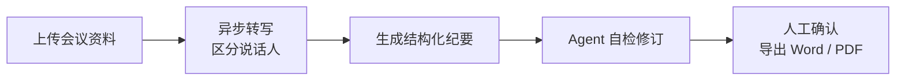

# AI 智能会议纪要辅助系统（AIMeeting）

把一场会议的录音、视频或资料变成一份**可确认、可导出**的结构化会议纪要：



> 本仓库是原版课程项目的整理版：后端 FastAPI + Tortoise ORM + MySQL，前端 Vue 3 + Element Plus，
> 业务链路与课程源码保持一致；工程外壳（Docker Compose 部署、初始化 SQL、CI）在课程源码基础上补齐。
> 部署与运维细节见 [DEPLOYMENT.md](DEPLOYMENT.md)。

## 这个项目是什么

企业内部使用的「会议录音 → 结构化纪要」辅助系统，由两部分组成：

- **后端** `meetingbot/fastapi-app/`：FastAPI + Tortoise ORM + MySQL 8，
  负责认证、会议与资料管理、异步转写、纪要生成、Agent 自检与运行观测；
- **前端** `meetingbot/vue/`：Vue 3 + Element Plus 管理端 SPA，
  生产环境由 nginx 托管静态资源，并把 `/api/`、`/files/` 反代到后端（同源部署）。

一句话概括设计取向：**模型只做建议，产物必须人工确认后才写回业务数据**。

## 五步工作流

1. **上传会议资料**：会议下上传录音、视频或附件（单文件 ≤ 500MB），后端按 SHA-256 去重，
   按扩展名分类为 AUDIO / VIDEO / ATTACHMENT，支持在线预览与下载。
2. **异步转写并区分说话人**：FFmpeg 切成固定时长分片，逐片调百炼录音文件识别，
   再重建时间轴与说话人标签；页面轮询进度，片段可人工修订。
3. **生成结构化纪要**：转写按字符数分块（map）提取后合并（reduce），产出六块结构：
   `summary` 摘要、`topics` 议题、`viewpoints` 发言观点、`decisions` 决策、
   `pending_items` 待确认事项、`risks` 风险与争议。
4. **Agent 自检修订**：LangGraph 反思环 `review → refine → finalize`，轮数有上限；
   页面经 SSE 实时看到时间线；模型修订稿只落在运行记录里，**不会直接覆盖纪要**。
5. **人工确认与导出**：人决定「应用修订稿 / 放弃」；纪要确认归档后导出 Word / PDF；
   运行观测页可复盘每次模型调用的状态、耗时与失败原因。

## 技术栈

| 层 | 选型 |
|---|---|
| 后端 | Python 3.12、FastAPI、Tortoise ORM、MySQL 8、Pydantic 2、PyJWT、HTTPX、Uvicorn |
| AI | LangChain（langchain-core / langchain-openai）、LangGraph、阿里云百炼（DashScope） |
| 导出 | python-docx（Word）、reportlab（PDF，中文字体） |
| 前端 | Vue 3、Vite 5、Vue Router、Element Plus、Axios、ECharts |
| 部署 | Docker Compose（MySQL + 后端 + nginx 前端 + 可选测试容器）、GitHub Actions |

## 目录结构

```text
.
├── meetingbot/
│   ├── fastapi-app/            # 后端：api / services / common / models.py / tests
│   │   ├── Dockerfile          # 后端镜像（含 ffmpeg 与中文字体）
│   │   └── requirements*.txt
│   └── vue/                    # 前端：Vite 工程 + Dockerfile + nginx.conf
├── db/                         # MySQL 初始化镜像：01-schema.sql（13 表）+ 02-seed.sql
├── compose.yaml                # 本地 Docker 编排（只绑定 127.0.0.1）
├── scripts/                    # compose 封装脚本（bash / PowerShell）
├── DEPLOYMENT.md               # 部署与运维说明
└── .github/workflows/ci.yml    # 后端单测 + 前端构建
```

## 功能一览

- 认证与账号：登录、注册、改密、个人资料；
- 组织与员工：部门 CRUD、员工账号 CRUD、部门成员、会议候选人；
- 会议中心：会议 CRUD、参会名单、开始/结束/取消、删除预览与级联删除；
- 会议资料：500MB 流式上传、会议内 SHA-256 去重、分类与在线预览、下载、批量删除；
- AI 模型配置：转写 / 纪要 / 自检 / 说话人匹配 4 种用途，同用途只允许一条启用；
- Prompt 模板：5 条预置模板可改，保存时校验必需变量；
- 转写任务：发起、重试（上限 3 次）、删除、详情、片段修订、说话人手动匹配 + 模型建议；
- AI 会议纪要：异步生成（map-reduce）、重试、在线修订、确认/取消确认、导出 Word/PDF、删除；
- 纪要自检：LangGraph 反思环、SSE 实时进度、中断/恢复、时间线、应用/放弃修订稿；
- 运行观测：8 张指标卡 + 4 张 ECharts 图 + 模型/步骤排行 + 最近失败 Top10，按角色收窄数据范围。

## 数据模型

13 张表、零外键，关系与幂等约束由应用层 + 唯一索引保证：

| 域 | 表 |
|---|---|
| 组织 | `department`、`user` |
| 会议 | `meeting`、`meeting_participant`、`meeting_material` |
| 转写与纪要 | `transcription_task`、`transcript_segment`、`meeting_minutes`、`agent_run`、`agent_step` |
| 配置与审计 | `ai_model_config`、`prompt_template`、`ai_call_log` |

## 快速开始

### 方式一：Docker Compose（推荐）

```bash
cp .env.example .env          # Windows PowerShell: Copy-Item .env.example .env
# 编辑 .env：至少填写 MYSQL_PASSWORD、MYSQL_ROOT_PASSWORD、JWT_SECRET
docker compose up -d --build
```

启动后访问 `http://127.0.0.1:18083`（后端只绑定 `127.0.0.1:19092`）。
数据库初始化脚本会创建 13 张表与演示账号：`admin/admin`、`employee/123456`、`operator/123456`
（**明文口令，仅课程/本地演示使用**）。

### 方式二：本机开发

1. 本机 MySQL 8 建库 `ai_meeting`，导入 `db/01-schema.sql` 与 `db/02-seed.sql`
   （或在 MySQL 客户端里直接执行这两个文件）；
2. 后端：
   ```bash
   cd meetingbot/fastapi-app
   python -m venv .venv && . .venv/bin/activate     # Windows: .venv\Scripts\activate
   pip install -r requirements.txt
   python main.py                                    # 默认 http://localhost:9090
   ```
   数据库连接默认 `localhost:3306 / root / 123456 / ai_meeting`，可用环境变量
   `MYSQL_HOST/MYSQL_PORT/MYSQL_DATABASE/MYSQL_USER/MYSQL_PASSWORD` 覆盖；
3. 前端：
   ```bash
   cd meetingbot/vue
   npm install
   npm run dev        # 默认 http://localhost:5173，接口指向 .env.development 的 VITE_BASE_URL
   ```

### 转写/纪要/自检所需的外部服务

四类模型配置在数据库里预置但 **API Key 为空**：登录管理员 → 「AI模型配置」填写百炼 Key 并启用
（转写 / 纪要 / 自检至少各启用一条，说话人匹配可选）。转写依赖本机或容器内的 `ffmpeg`。

## 测试

```bash
cd meetingbot/fastapi-app
pip install -r requirements-dev.txt
python -m unittest discover -s tests -p 'test_*.py'
```

后端 43 个用例，使用 sqlite 内存库与 mock 模型，不连 MySQL、不调真实模型；
需要系统 `ffmpeg` 的用例在缺失时会自动 skip。

## 演示素材

`meetingbot/fastapi-app/files/`（约 27MB 录音/视频/文档）**未提交到仓库**，仅本地运行或演示时使用；
如需完整演示数据，可从原课程项目素材目录复制一份到该路径，或自行上传会议资料。

## 已知边界（个人/课程项目，不是生产系统）

- 单进程假设：转写 / 纪要 / 自检三类任务跑在 FastAPI 进程内（asyncio + 内存字典 + 启动恢复），
  只能 `--workers 1`、单副本；多副本会重复执行；
- 密码明文存储与比较、JWT 默认密钥在源码里、CORS 全开、无速率限制、无迁移工具、无质量评测；
- 数据模型零外键，删除靠手写级联，`ai_call_log` 不随业务删除清理。
  上生产前需要先补安全与任务外置，详见 `DEPLOYMENT.md` 的「单进程限制」。

## License

MIT，见 [LICENSE](LICENSE)。
