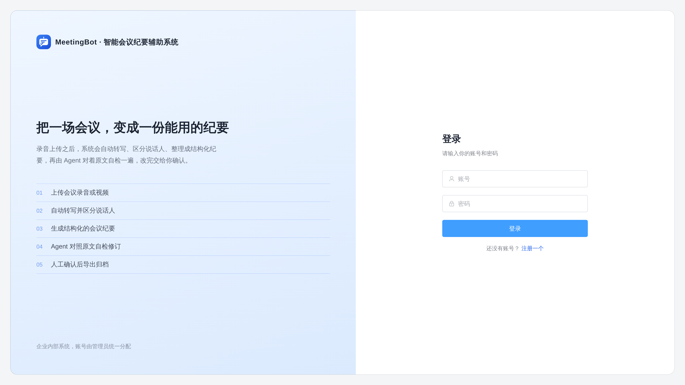
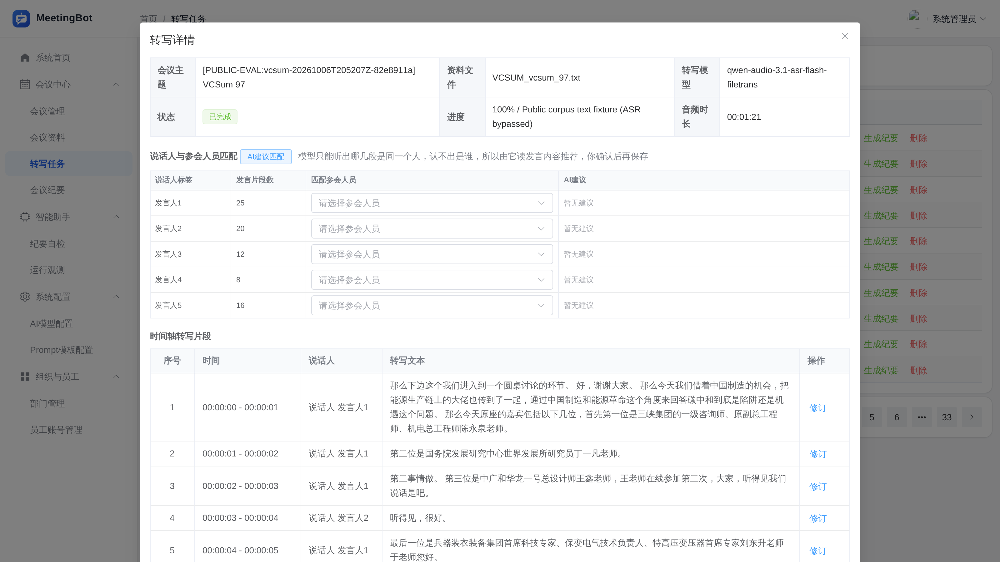
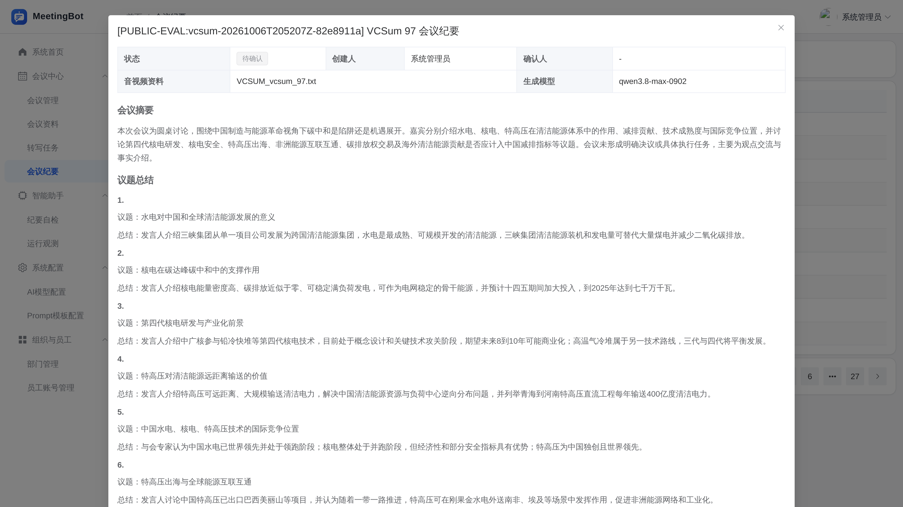
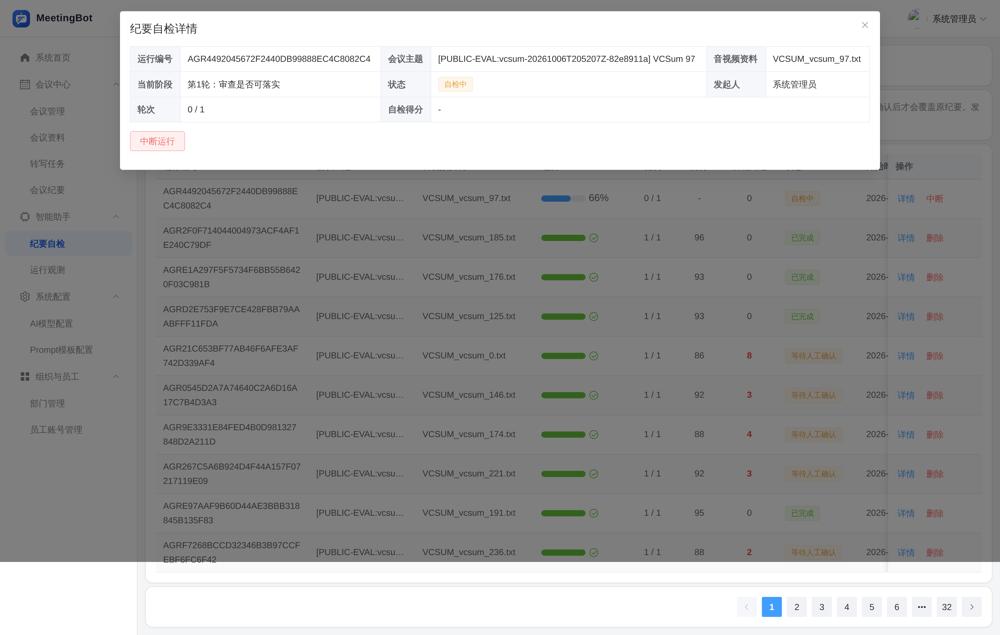
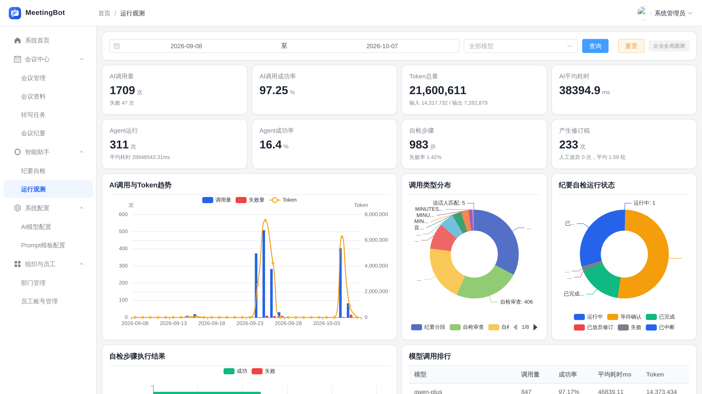
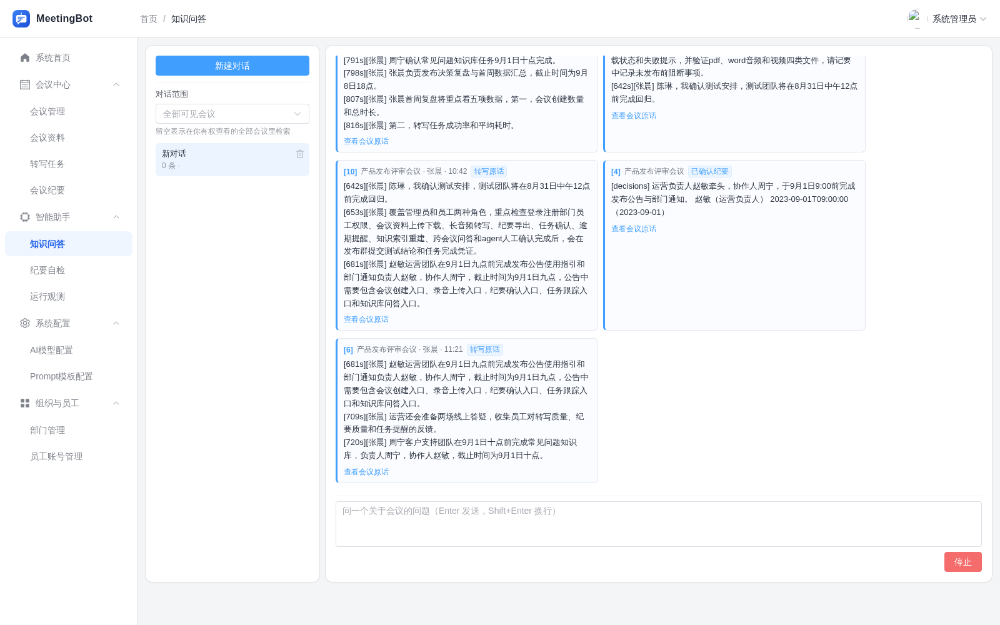
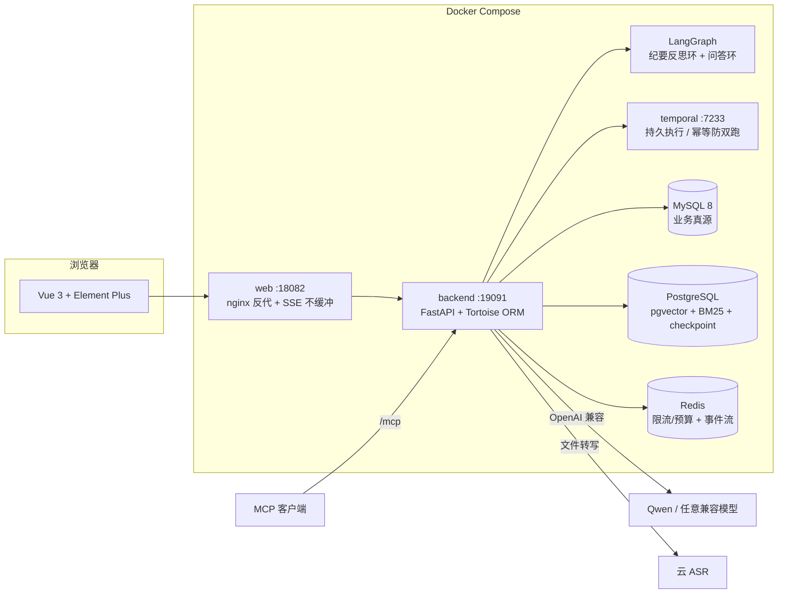

# MeetingBot

**一场会开完，纪要已经能用了。**

录音或视频传进来，MeetingBot 负责剩下的：转写（谁说了什么）→ 六字段结构化纪要 → Agent 对着原文自检一遍 → 人工确认归档 → 进知识库可检索可问答（答案带可点回的引用）。会议可以归入系列，确认后的决策/待办进入系列级长期记忆与看板；问答按会议或系列收窄，工具只读、人拍板才算数。FastAPI + Vue 3 + MySQL + PostgreSQL（pgvector + ParadeDB BM25 + checkpoint）+ LangGraph + Temporal + MCP，Docker Compose 一条命令起全套。

[](https://www.python.org/)
[](https://fastapi.tiangolo.com/)
[](https://vuejs.org/)
[](https://element-plus.org/)
[](https://www.mysql.com/)
[](https://github.com/langchain-ai/langgraph)
[](https://temporal.io/)
[](https://www.paradedb.com/)
[](https://modelcontextprotocol.io/)
[](compose.yaml)
[](LICENSE)
[](https://github.com/LittleSongxx/MeetingBot/actions/workflows/ci.yml)



## 一场会议在这里经历什么

**① 上传**：会议资料页上传音视频，按内容哈希去重（同一会议内同一份文件不会存两遍）。

**② 转写**：FFmpeg 抽单声道音轨后走云 ASR 单请求直传（说话人分离），逐段落到数据库；片段支持人工修订，说话人拿不准时可以一键让 LLM 从参会人名单里给建议。



**③ 纪要**：单遍长上下文调用生成六字段结构化纪要——概要、议题、观点、决策、待办、风险；每个字段带类型化槽位与证据来源，契约层把「不许凭空断言」做成数据结构不变量。



**④ 自检**：LangGraph 状态机跑「审查 → 重写 → 复审」反思环，Agent 对着转写原文核对六块内容，全程 SSE 流式推给前端；修订稿必须人工确认才会覆盖原纪要。



**⑤ 确认归档**：确认后的纪要一键导出 Word / PDF；运行观测页把每次模型调用记账——成功率、Token 用量、失败原因，卡的住的证据都在。



**⑥ 知识问答**：转写成功自动建索引、纪要确认后权威入库；用户在「知识问答」页提问，检索走 PostgreSQL pgvector dense + ParadeDB BM25（应用层 RRF 融合；PG 不可用时本轮没有检索依据，由 no_retrieval 闸标注），回答逐 token 流式渲染，引用编号可点回原会议原句。同一组工具也通过 MCP（`/mcp`）暴露给外部客户端——**一个工具层、两种传输**。



截图是实拍：种子会议（两段录音）索引后问"发布前必须完成哪些任务"，回答带 5 张引用卡片，
每张标明出处（会议 · 说话人 · 时间 · 权威级）并可点回原句。

## 转写：谁在什么时候说了什么

- 云端 ASR 单请求直传整段录音，一次调用拿到带说话人标签的分段结果，不再切块拼接
- 时长预检（≤2h）先拦一道，超长录音在入队前拒绝，不浪费调用
- 引擎可切换：默认云端（DashScope 文件转写），也可以指向本地侧车（FunASR + MOSS-Transcribe-Diarize）
- 片段级人工修订：改错字、合并拆分、重指说话人都落在 `transcript_segment` 表，可回溯
- 说话人建议是 suggestion-only：LLM 只从参会人名单里选，采纳与否由人决定

## 纪要：六个字段，每个都有出处

- 概要 / 议题 / 观点 / 决策 / 待办 / 风险，Pydantic 模型由契约层派生，结构化输出走 strict JSON Schema
- 每个槽位带类型（是否明说、是否推导、是否未提及）与来源闭合（origin + 证据 span），展现层做版本适配
- 磁盘调用缓存按「模型 + 提示词」哈希去重，重试不会为已经成功过的调用重复付费
- 修订、确认 / 取消确认、强制结束三条状态出口都在页面上，状态流转全部留痕

## 自检：改完必须人工确认

- 审查、重写、汇总、中断检查四个动作由 LangGraph 编排，图本身不碰数据库和模型，动作注入，可独立测试
- 每一步的输入输出、判定依据存 `agent_step`，运行状态机覆盖中断与恢复
- SSE 把步骤实时推到前端，长任务不用轮询
- 修订稿与原稿并存，人工确认前不覆盖；确认后原稿进入历史

## 知识库：人拍板的内容才进库

- 摄入挂在已有状态迁移上：转写成功 → 索引全文（RAW）；**纪要确认 → 索引权威条目（CONFIRMED），草稿永不进库**
- 切片：转写按片段边界聚合成重叠窗口（目标 300 字、重叠 2 句），纪要按条目切；切片 id 同时是 PG 向量行主键，不做第二套编号
- 混合检索：PostgreSQL 里的 pgvector dense 与 ParadeDB BM25（中文 jieba 分词）各召回一批，在应用层做 RRF；RRF 只看排名，规避两路分数量纲不同。PG 不可用时检索不可用，并在 `/chat/status` 如实报告
- 索引生命周期：MySQL 状态变更写 outbox，后台 reconcile 同步 PG 派生索引；检索再按 MySQL 状态兜底，取消确认/删除后的旧切片不会交给模型
- **权限过滤发生在检索层**：`None`＝不过滤（管理员）、空列表＝无可见会议，两种语义分开，混用即越权
- 幂等三层：workflow id、任务条件抢占、内容指纹；内容未变时跳过重建，失败任务保留已嵌入切片与错误原因，手动重建时不会重复处理已成功的来源

## 问答：一个工具层，两种传输

- 单 Agent + 五工具（检索 / 结构化事实 / 取纪要 / 取转写原文 / 查已确认状态）：业界建议 3–5 个，每多一个都降低选择可靠性
- 事实类问题走**具名参数查询**，不做自由文本转 SQL（那同时带来注入面与幻觉 SQL）
- 三道硬闸由代码兜住：最大轮数、token/成本预算、停滞检测——终止由模型判定，上限必须由代码守
- 回答逐 token 经 SSE 推送（`astream_events` v2，15 秒心跳，反代禁用缓冲），引用编号由宿主分配、答案写 `[n]`，页面渲染成可点回原句的卡片
- **答案 grounded 协议**：每条事实性结论紧贴引用编号 `[n]`；推断显式标【推断】；无引用支持的解释不写；系列/跨会议/否定确认题先完整回应再给依据（Hybrid 条件风格）
- **状态查询**：`query_meeting_state` 只返回人工确认过的决策/结论、有效待办与本人偏好；待办状态以 `action_item` 为准，未确认候选不得当事实
- **注入防护**：转写/材料/工具结果一律标注为 `trust=untrusted`，指令层级写进系统提示；命中只加警示与留痕，不改证据原文（否则引用无法定位）
- **MCP**：同一组工具以 streamable HTTP 挂在 `/mcp`（stateless），鉴权复用同一个 JWT 校验（含密码指纹），权限判在工具内部——所以中间件（限流/追踪）随父应用自动继承，也不存在"MCP 侧忘了判权"这条路

## 系列、记忆与待办：跨会议的事实层

- **系列**：一场会最多归入一个系列（周会/项目例会）；系列可见 = 旗下至少一场会可见，编辑 = 负责人或管理员。支持手动归类与「建议系列」（相似标题 + 参会人重叠 + 主持人，只建议不自动写）
- **记忆**：系列级决策/结论 + 用户级偏好，分 PROPOSED → CONFIRMED；只有确认后的条目进入问答工具；同 scope/kind 冲突时由人选择「替代」，旧条标 SUPERSEDED 并保留有效期
- **待办**：确认纪要的待办条目自动生成，同一系列内按归一化文本去重/结转；状态 OPEN/DONE/BLOCKED/CANCELLED 只能在页面改，每次变更写 `action_item_event` 留痕
- **范围**：问答可按会议或按系列建会话；系列只存 id，每轮按当前可见会议展开，权限收回后旧会话自然看不到新内容
- **Agent 只读**：没有写工具；"改状态/确认记忆"只发生在页面，工具只负责查

## 观测：每次调用都记账

- 每次模型调用写一行 `ai_call_log`：调用类型、耗时、Token、失败原因——「一行 = 一次真实调用」
- 失败分类器把超时 / 连接 / 限流 / 服务端错误分开，重试策略只对瞬态错误生效
- 观测页按天汇总趋势、成功率与模型排行，员工视角按业务归属过滤
- 在线评测（管理员手动触发、单次 ≤50 条）用 JUDGE 模型给最近回答打忠实度/相关性，结果只做趋势与回归输入，不替代离线评测
- 成本看板按会议归因、按问答轮均摊，缓存命中只报供应商上报的 `cache_read`/`cached_tokens`；模型路由为空时行为与改造前一致，路由默认关闭

## 架构



| 链路 | 走过谁 |
|---|---|
| 转写链路 | 上传 → Temporal 提交任务 → ASR → 分段落库 →（可选）说话人建议 → 自动建索引 |
| 纪要链路 | 转写就绪 → 单遍长上下文生成 → 契约校验 →（可选）自检反思环 → 人工确认 → 导出 + 权威入库 |
| 问答链路 | 提问 → 检索（PostgreSQL pgvector dense + ParadeDB BM25，应用层 RRF）或结构化查询 → 带引用回答 → 逐 token 流式渲染 → 引用点回原句；PostgreSQL checkpoint 支持断线续跑 |

转写 / 纪要 / 自检 / 索引四类长任务全部走 Temporal 持久执行：workflow id 幂等防双跑、崩溃自动续跑，**每类任务一个队列、并发上限各自可配**（一类打满不影响另一类）。链路里每一环都能在代码里指到，详细分层与"五处统一串联"见 [docs/架构.md](docs/架构.md)。

## 技术栈

- **后端**：Python 3.12 · FastAPI · Tortoise ORM · Pydantic v2 · LangChain / LangGraph · MCP SDK
- **调度**：Temporal（durable execution，四类长任务，按类型分队列）
- **前端**：Vue 3 · Vite 5 · TypeScript（strict，`vue-tsc` 进 CI）· Element Plus · ECharts · markdown-it + DOMPurify
- **数据**：MySQL 8（业务真源，19 张表）+ PostgreSQL（pgvector dense + ParadeDB BM25 + LangGraph checkpoint）+ Redis（限流/预算 + 对话事件流，故障时 fail-open）
- **模型**：OpenAI 兼容接口（默认 Qwen3.8-Max + Qwen-Audio ASR），ASR 引擎可切换云端 / 本地侧车
- **部署**：Docker Compose 七服务 · FFmpeg · nginx
- **安全**：bcrypt 哈希 · JWT 密码指纹（改密即吊销）· 集中式滑动窗口限流（标准 429 头）· 内容审核三层 · 服务端 MIME + nosniff · 统一权限口径 · 工具内权限判定
- **可观测**：标准库 JSON 日志 · Prometheus `/metrics` · 应用级 trace_id + OTel GenAI span（OTLP 默认关闭）

```
meetingbot/
├── fastapi-app/                     # 后端
│   ├── api/                         # 路由：会议 / 资料 / 转写 / 纪要 / 自检 / 观测 / 配置
│   ├── services/                    # 领域服务：契约层 / 模型工厂 / 反思环 / Temporal 工作流
│   ├── common/                      # 基础设施：认证 / 限流 / JSON 修复 / 供应商能力表
│   └── tests/                       # 产品侧零调用测试
├── vue/                             # 前端：15 个管理页面（全量 TypeScript）
db/                                  # 建库脚本：01-schema.sql（结构）+ 02-seed.sql（演示数据）
                                     # 空卷初始化时按序导入；结构真源是 models.py，有漂移测试兜底
evaluation/                          # 评测体系（与产品代码物理隔离，只允许登记在案的四处委托）
├── README.md / DESIGN.md            # 评测宪法与四层设计书
├── LEDGER.md                        # 结论账本：可引用结论 + 撤回记录
├── asr/ benchmarks/ judges/ gate/ gold/ regression/ lib/ tests/
scripts/                             # compose.sh · 本地 ASR 侧车 · 索引脚本
docs/                                # 架构.md（五处统一串联）· 容量模型.md · 问答链路分析.md · 运行时与索引一致性.md
docs/assets/                         # logo 与 README 实拍截图
```

## 快速开始

```bash
cp meetingbot/fastapi-app/.env.example meetingbot/fastapi-app/.env
# 编辑 .env，至少填：
#   MYSQL_PASSWORD / MYSQL_ROOT_PASSWORD   数据库口令
#   PG_PASSWORD                            PostgreSQL（pgvector/BM25/checkpoint）口令
#   JWT_SECRET                             openssl rand -hex 32
#   DASHSCOPE_API_KEY                      模型密钥（不填服务也能起，调用会失败但页面可逛）
#   APP_ADMIN_PASSWORD                     管理员初始密码

./scripts/compose.sh up -d --build       # 七服务全起（db / postgres / redis / backend / web / temporal ×2）
```

配置统一从 `meetingbot/fastapi-app/.env` 读取（密钥不进根目录、不进镜像、不进版本控制）。种子数据带示例会议、转写、纪要与模型配置；管理员账号见 `.env` 的 `APP_ADMIN_USERNAME / APP_ADMIN_PASSWORD`（首次启动建号/改密）。

> `APP_ADMIN_PASSWORD` 留空时会沿用种子账号 `admin/admin`，仅供本地演示；公网部署必须设置强密码，并保持 `REGISTER_ENABLED=false`。

| 入口 | 地址 |
|---|---|
| 网页 | <http://127.0.0.1:18082> |
| 后端健康检查 | <http://127.0.0.1:19091/health> |
| Temporal | 127.0.0.1:17233（仅本机回环） |
| MCP 端点 | <http://127.0.0.1:19091/mcp>（streamable HTTP，需带 JWT） |
| 指标 | <http://127.0.0.1:19091/metrics>（Prometheus 文本） |

## 怎么验证它真的能跑

```bash
make -C evaluation smoke    # 零调用回归：契约不变量 / 证据可定位率 / 问答引用不变量 / 可靠性复算
make -C evaluation test     # 评测侧单测（336 项）
cd meetingbot/fastapi-app && .venv/bin/python -m unittest discover -s tests -p 'test_*.py'   # 产品侧单测（683 项，6 项条件跳过）
cd meetingbot/vue && npm ci && npm run type-check && npm run lint && npm run test   # 前端：类型 / lint / 单测
```

产品侧本地环境：`cd meetingbot/fastapi-app && uv venv --python 3.12 .venv && uv pip install --python .venv/bin/python -r requirements.txt`（pip 等价亦可）。

评测体系分五个入口：`smoke`（零调用回归）/ `deep`（裁判判读）/ `gate`（留出集门禁）/ `gold`（金标注与裁判校准）/ `rag`（轴 5 检索与回答）——`evaluation/README.md` 把这套写成"三层入口 ＋ 一个金标锚"，两种数法指的是同一份 `Makefile`：`gold` 是校准锚，算第三层的一部分还是独立一层而已。公开评测集（AliMeeting / VCSum）的语料与音频不入库，用 `evaluation/benchmarks/download_alimeeting.py` 按清单复得；live 运行有预算护栏并必须显式开启。

## 运维与排查入口

| 想做什么 | 入口 |
|---|---|
| 起停 / 看日志 | `./scripts/compose.sh up -d / stop / logs --tail=100 backend` |
| 后端健康 | `curl http://127.0.0.1:19091/health`（查 DB 连通） |
| 换模型 / 换密钥 | 改 `.env` 后 `./scripts/compose.sh up -d --force-recreate backend` |
| 失败调用排查 | 前端「运行观测」页，或直接查 `ai_call_log` 表 |
| 卡死的任务 | 纪要页「强制结束」出口（forceFail） |
| 问答质量与成本 | 「知识问答」页（引用卡片）+「运行观测」页（成本趋势与排行） |
| 限流参数 | `CHAT_ASK_LIMIT_PER_USER` / `CHAT_ASK_LIMIT_PER_IP` / `CHAT_DAILY_TOKEN_BUDGET`（见 `docs/容量模型.md`） |
| 内容审核 | 配 `MODERATION_WORDS` / `MODERATION_WORDS_FILE`；未配置时 `/chat/status` 会如实报告"未启用" |
| 部署细节与红线 | [DEPLOYMENT.md](DEPLOYMENT.md)（多副本与限流口径、密钥泄露处置、索引修复） |

## 决策记录

产品机制的默认值不是拍脑袋定的：每个候选机制先写预注册规则再跑数，过了门禁才翻转默认；不显著的结论如实登记「检不出」，撤回的结论连理由保留。这些记录连同证据路径都在评测账本里，按章节节选：

| 主题 | 记录在哪 |
|---|---|
| 转写切分参数的产品默认值 | [evaluation/LEDGER.md](evaluation/LEDGER.md) · 预注册：切分提默认的判定规则 |
| 单请求直传 vs 切块拼接 | `LEDGER.md` · R5 ASR 单请求复测（假设修正过程） |
| 自检反思环的保默认机制 | `LEDGER.md` · R3 保默认机制验证 |
| 优化机制的默认开关状态 | `LEDGER.md` · 产品机制状态表 |
| 问答引用的两条零调用不变量（首测 100%/100%，n=27 轮） | `LEDGER.md` · 问答引用（零调用不变量） |
| 首次真实运行的四个产品缺陷 | `LEDGER.md` · 本轮真实运行暴露的产品缺陷 |
| 轴 5 检索与回答的基线口径 | `LEDGER.md` · 预注册：轴5 检索与回答四指标基线 |
| 全部撤回与存疑结论 | `LEDGER.md` · 存疑与已撤回 |
| 质量指标全面分析与本轮通用优化方案（2026-10-22） | [docs/质量指标全面分析与通用优化方案.md](docs/质量指标全面分析与通用优化方案.md) · [docs/质量指标全景与缺口分析.md](docs/质量指标全景与缺口分析.md) |
| 答案级证据校验与有界修复实验（+0.5/+1.7pp，未过 +5pp，不产品化） | `LEDGER.md` · §40 预注册 / §40b 结果 |
| 引用证据快照补全、RAG 质量闸归属错分离（产品侧零调用修复） | `services/citations.py`、`services/rag_quality.py`；单测 `tests/test_citations.py`、`tests/test_rag_quality.py` |
| 可检索事实召回 recall-v2（context_recall 换仪器：剔除 metadata/fixture/conflict） | [evaluation/reports/2026-10-22_recall_instrument_fix.md](evaluation/reports/2026-10-22_recall_instrument_fix.md) · `evaluation/gold/fact_classes.json` · `LEDGER.md §42` |
| 质量闸加固：旧口径+recall-v2 双行、95% CI、产物 sha256 校验和 | `evaluation/quality_gate.py`、`evaluation/baselines/quality_gate_baseline.json`、`make -C evaluation quality-gate` |
| 工具契约扩展（系列/状态元数据；cross30 recall-v2 +5.60pp，泛化集 mixed+10/new 中性） | [tool enrichment 报告](evaluation/reports/2026-10-23_tool_enrichment.md) · `services/tool_metadata.py` · `LEDGER.md §53–§53d` |
| 行动项槽位守卫（owner/deadline/evidence 必须在转写里可定位；确认后写待办前降级） | [action guard 报告](evaluation/reports/2026-10-23_action_item_guard.md) · `services/action_validate.py` · `LEDGER.md §51` |
| 轨迹 pass^k 可评化（pass^3=85.19%，k=3，81 trial；此前 not_evaluable） | [pass^k 报告](evaluation/reports/2026-10-23_trajectory_passk.md) · `LEDGER.md §49b/§49g` |
| 生成后引用绑定（默认开，零模型调用；cited-gap 4 次 A/B −8.35pp，配对回放 faith +1.06pp） | [evidence binding 报告](evaluation/reports/2026-10-23_evidence_binding.md) · `services/citation_bind.py` · `LEDGER.md §49–§49f` |
| 单次 100 题 fresh 运行 + 重复运行 ×2（P0-2；单次波动≈5pp，三次均值 −0.87pp 但极差 5.000085pp>5pp → 保留组装集） | [eval100 fresh run](evaluation/reports/2026-10-22_eval100_fresh_run.md) · [重复运行报告](evaluation/reports/2026-10-23_eval100_fresh_repeat.md) · `LEDGER.md §43/§43b/§46/§46b` |
| RAGAS 0.4.3 官方口径 + Hybrid 条件回答风格（100 题×3；faith 89.57 / AR 91.72 / CR 90.57 / CP 69.45；CP 官方目标 75–80，不混旧自研口径） | [hybrid final](evaluation/reports/2026-10-28_hybrid_final.md) · [baseline](evaluation/baselines/ragas_official_hybrid_baseline.json) · `LEDGER.md §OPT-4` |
| MOSS 本地 SA-ASR 直接采用（8/8 自身指标；产品链路 13.99% vs 直连 12.35%，+1.64pp；长场容量 62.87min→守卫 2700s/超时 2400s） | [docs/MOSS-ASR启用.md](docs/MOSS-ASR启用.md) · [自身指标](evaluation/reports/2026-10-22_moss_own_metrics.md) · [产品链路验证](evaluation/reports/2026-10-23_moss_product_link.md) · [长场容量](evaluation/reports/2026-10-23_moss_long_audio_capacity.md) · `LEDGER.md §45/§47/§48` |
| 缺失类审查意见的前提语义校验（只对 MISSING_DEADLINE 要求时间语义，含软期限；MISSING_OWNER 不做线索过滤，避免误伤合法意见） | `services/contracts.py`；单测 `tests/test_contracts.py` |
| MOSS 执行侧修复（worker env/镜像、显式 max_new_tokens、覆盖率守卫、实际模型名展示） | `services/transcription_service.py`、`api/transcription.py`、`scripts/moss_asr_server.py`；单测 `tests/test_transcription.py` · `LEDGER.md §47b/§47d` |
| Claim 级人工锚点包 + 子 Agent 代审校准（α=0.426<0.70 → claim 级裁判只作方向信号） | [evaluation/gold/claim_anchor_cross30_100.csv](evaluation/gold/claim_anchor_cross30_100.csv) · `evaluation/gold/claim_anchor_score.py` · [evaluation/reports/2026-10-22_claim_anchor_calibration.md](evaluation/reports/2026-10-22_claim_anchor_calibration.md) · `LEDGER.md §44/§44b` |

## 评测与项目文档入口

- [质量仪表盘](docs/quality_dashboard.html)（零调用生成：五轴记分卡、机制 A/B、质量闸）
- [指标现状与优化决策](docs/指标现状与优化决策.md)（达标/收口/待优化一页总表）
- [RAGAS 官方口径最终报告](evaluation/reports/2026-10-28_hybrid_final.md) · [冻结基线](evaluation/baselines/ragas_official_hybrid_baseline.json)（100 题×3；Hybrid 回答风格前后对比与 CP 口径边界）
- [RAG 收口（历史）](evaluation/reports/2026-10-23_rag_closeout.md)（旧自研口径冻结读数）
- [TTFT / 首 token 实测](evaluation/reports/2026-10-23_ttft_latency.md)（RAG 链路延迟分解）
- [延迟 / 成本 / 可观测性现状](docs/可观测性与延迟成本现状.md)（已测/未测与 P0–P2 计划）
- [泛化与过拟合审计](docs/泛化与过拟合审计.md)（机制风险表、静态守门测试、后续泛化约束）

## 这个仓库里没有的东西

- **没有语料与音频**：AliMeeting / VCSum 评测语料与会议音频不入库（体积与数据集许可），脚本按清单复得；评测证据与运行账本在库。
- **没有外部基础设施依赖**：PostgreSQL / Redis 都在 compose 里（不映射宿主端口）；模型走 OpenAI 兼容接口；换供应商除改 `.env` 外，还要求该供应商支持 `MINUTES/AGENT/SPEAKER` 的 strict `json_schema`（启动时会校验）。Redis 故障时限流与预算闸 fail-open（放行并记日志），不阻断业务；PG 不可用时检索不可用（由 no_retrieval 闸标注）、checkpoint 不启用（已落库消息不受影响）。
- **没有内置敏感词表**：合规口径取决于部署地与业务，词表由 `MODERATION_WORDS` / `MODERATION_WORDS_FILE` 提供；未配置时审核如实报"未启用"。
- **没有密钥**：`.env` 与任何密钥都不在版本控制内，仓库只有 `.env.example`。
- **没有个人资料**：仓库只含项目代码、评测资产、项目文档与实拍截图；简历、JD/面经调研、复盘、作品集等个人求职材料不入公开仓库（`docs/resume/` 及 `analysis/` 下的相关文件已在 `.gitignore` 排除）。

## 许可

- 本项目使用 [MIT 许可证](LICENSE)，可自由使用、修改与商用，保留版权声明即可。
- 使用云模型服务（Qwen / ASR）时请遵守对应供应商的服务条款；评测数据集的使用请遵守数据集自身的许可。
