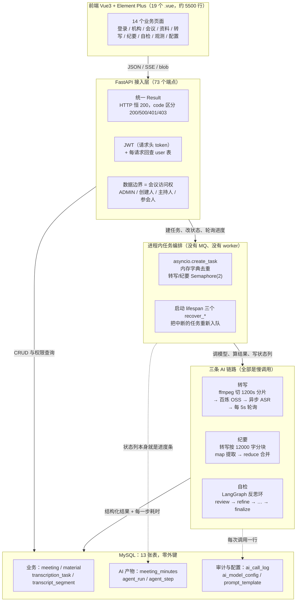
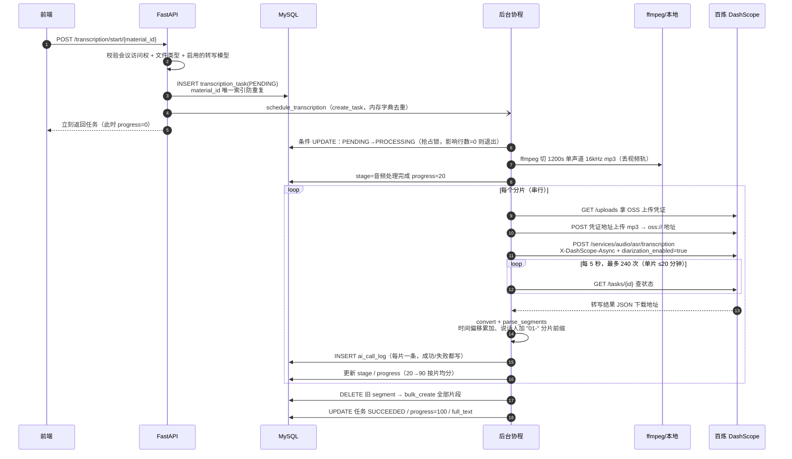
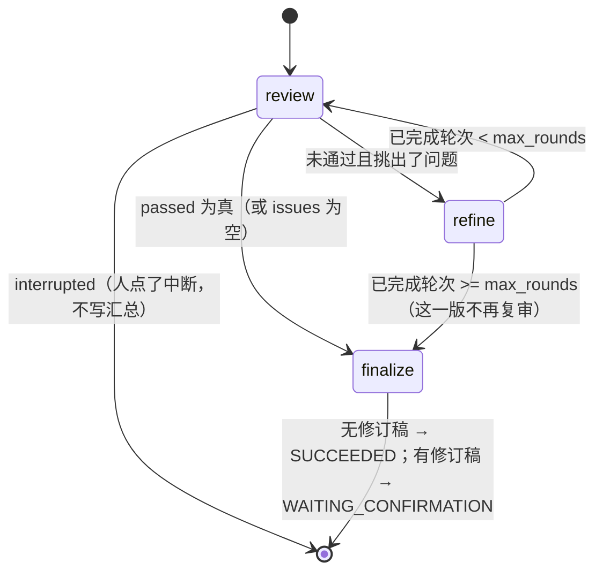
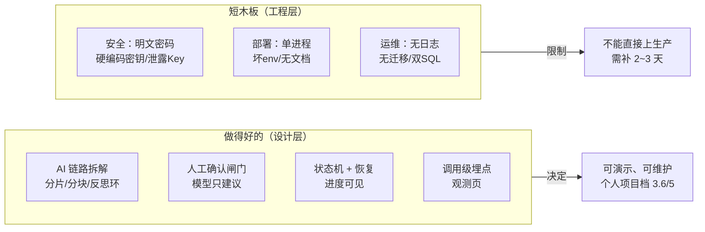

# AI 会议纪要助手（AIMeeting）：一条"不信任模型"的会议处理流水线

> 分析对象：`ai_meeting/`（FastAPI + Tortoise ORM + MySQL + LangChain/LangGraph 后端，Vue 3 管理端前端）。
> 分析方式：只读静态阅读源码与两个 SQL 脚本；**未启动服务、未连库、未调用外部模型**。带"推断"的结论均已标注。
> 证据附录（详细行号、端点清单、契约对照表）：`架构图/调研/AI链路.md`、`架构图/调研/后端接口与数据模型.md`、`架构图/调研/前端.md`、`架构图/调研/质量与成熟度.md`。
> 证据等级：**直接** = 代码/DDL 字面可证；**支持性** = 测试/配置/种子数据旁证；**推断** = 由代码路径推出、未运行验证。

**一句话结论：这个项目的一切设计都源于同一个根约束——"模型是这条链路上唯一既慢、又可能漏、又可能编造，且无法被工程手段消除不确定性的环节"。所以它把工程量主要花在给模型加边界（分片、强 Schema、自检、人工确认、全量埋点）上，而不是花在"让 Prompt 更聪明"上。**



**先看哪里**：先看 `services/agent_graph.py:102-131`（3 个节点、4 条边的反思环，全项目最"像 Agent"的 30 行）和 `services/transcription_service.py:404-496`（一次转写从抢占到落库的完整生命周期），这两个文件能解释整个系统的骨架。**这张图看不到什么**：所有失败分支（模型超时、分片失败、进程被杀、并发抢锁）、恢复路径，以及"人"在其中的位置——那些都在下面第 3、4 节。

---

## 1. 项目是什么

| 项 | 事实 | 证据 |
|---|---|---|
| 定位 | 企业内部"会议录音 → 结构化纪要"辅助系统，管理端 SPA + API 服务 | `vue/src/router/index.js:22-52`、`vue/src/views/Login.vue:11-12` |
| 形态 | 两个可独立部署的部分：`fastapi-app`（后端 API，端口 9090）+ `vue`（前端 Vite dev server） | `fastapi-app/main.py:59-60`、`vue/vite.config.js:11-24` |
| 代码量 | 后端 28 个 .py / 5467 行（不含测试）；测试 9 个文件 / 1117 行 / **43 个用例**；前端 27 个文件 / 5487 行 | 目录实测 |
| 技术栈 | Python 3.12.10 + FastAPI 0.141.1 + Tortoise ORM 1.1.8 + MySQL 8.0.40 + LangChain 1.6.4 + LangGraph 1.2.12 + httpx；Vue 3.5.41 + Vite 5.4.21 + Element Plus 2.14.5 + axios + echarts；导出 python-docx + reportlab | `fastapi-app/requirements.txt:1-44`、`vue/package-lock.json` 实际版本 |
| 数据 | 13 张表；`ai_meeting/ai_meeting.sql`（39.9KB，干净初始化脚本）与根目录 `ai_meeting.sql`（92KB，现场库 Navicat dump，带演示数据）**两套脚本并存且内容不一致** | 两个 SQL 文件对比 |
| 定位证据 | 注释大量出现"第 N 章"字样、逐行中文解释、教学式命名，明显是**毕业设计/课程项目**的写法 | 全仓注释风格 |

它**刻意不做**的三件事（比"做了什么"更能解释设计）：

1. **不做实时转写/多用户协作**——转写是"会后上传录音再处理"，接口全部是 POST 建任务 + 轮询看进度（`api/transcription.py:183-236`）。
2. **不引入消息队列/任务框架**——三类耗时任务都跑在 FastAPI 进程内，用 `asyncio.create_task` + 内存字典去重 + 启动时 `recover_*` 兜底（`services/transcription_service.py:499-527`、`minutes_service.py:178-200`、`agent_service.py:436-460`）。这是本项目和"生产级"最本质的分界线。
3. **不让模型直接改业务数据**——模型产出的修订稿只落在 `agent_run.revised_json`，必须人点"用修订稿覆盖"才会写回 `meeting_minutes`（`api/agent.py:205-252`、`services/agent_service.py:341-351`）。说话人匹配同理，模型只给建议，人点"采纳"才落库（`api/transcription.py:444-459`）。

---

## 2. 功能全景：10 个业务域、14 个页面

| # | 业务域 | 能力 | 关键实现 |
|---|---|---|---|
| 1 | 认证与账号 | 登录、注册、改密、个人资料、当前用户 | `api/__init__.py:57-117`；JWT 在 `common/auth.py` |
| 2 | 组织与员工 | 部门 CRUD、员工账号 CRUD（含批量删除）、部门成员、会议候选人 | `api/department.py`、`api/user.py` |
| 3 | 会议中心 | 会议 CRUD、参会人名单、状态流转（开始/结束/取消）、删除预览与级联删除 | `api/meeting.py:225-384` |
| 4 | 会议资料 | 500MB 流式上传、SHA-256 去重、AUDIO/VIDEO/ATTACHMENT 分类、7 种在线预览、下载、批量删除 | `api/meeting_material.py:89-340` |
| 5 | AI 模型配置 | 4 种用途（转写/纪要/自检/说话人匹配）、Key 掩码回显、同用途只允许一条启用 | `api/ai_model.py:36-201` |
| 6 | Prompt 模板 | 5 条预置模板可编辑、必需变量校验、只能改不能增删 | `api/prompt_template.py:51-103` |
| 7 | 转写任务 | 发起/重试/删除/列表/详情、片段人工修订、说话人手动匹配 + LLM 建议匹配 | `api/transcription.py`、`services/transcription_service.py` |
| 8 | AI 会议纪要 | 异步生成（map-reduce）、重试、在线修订、确认/取消确认、导出 Word/PDF、删除 | `api/meeting_minutes.py:95-343` |
| 9 | 纪要自检 | 发起反思环、SSE 实时进度、中断/恢复、详情时间线、应用/放弃修订稿 | `api/agent.py`、`services/agent_service.py`、`services/agent_graph.py` |
| 10 | 运行观测 | 8 张指标卡、4 张 ECharts 图、模型调用排行、步骤排行、最近失败 Top10；管理员看全局、员工看本人 | `services/observability_service.py:80-249` |

规模上最值得一提的是：**73 个端点里 49 个只要求登录、17 个要求管理员、3 个完全公开**（登录、注册、头像下载）——权限模型不是 RBAC 表，而是"JWT 门票 + 每请求回查用户 + 会议访问权"这一层数据边界（`common/auth.py:21-48`、`api/meeting.py:93-112`）。

---

## 3. 完整工作流

### 3.1 用户视角：五步（前端登录页把这条链路直接写成了产品剧本）

> `vue/src/views/Login.vue:61-67` 原文：01 上传会议录音或视频 → 02 自动转写并区分说话人 → 03 生成结构化的会议纪要 → 04 Agent 对照原文自检修订 → 05 人工确认后导出归档。

对应的真实操作路径：

```
管理员一次性配置：部门/员工 → AI 模型配置（填百炼 Key 并启用）→ Prompt 模板（可改内容）
        ↓
会议管理：新建会议（主题/时间/主持人/参会人）→ 上传录音/视频/文档
        ↓
会议资料页：点"发起转写" → 后台异步转写，页面 3 秒轮询进度
        ↓
转写任务页：看时间轴片段 → 人工修订错字 → 可选"AI 建议说话人" → 人工采纳
        ↓
点"生成纪要" → 跳纪要页看进度 → 草稿生成后可在线修订
        ↓
点"Agent 自检" → 跳自检页，SSE 实时看时间线 → 有修订稿时人工"应用/放弃"
        ↓
纪要页：确认归档 → 导出 Word / PDF → 运行观测页复盘模型调用与失败
```

这条链路的状态在四个状态机之间流转（全部是字符串列，无状态机框架）：

| 对象 | 状态转移 | 证据 |
|---|---|---|
| 会议 `meeting.status` | `SCHEDULED → IN_PROGRESS → FINISHED`；`SCHEDULED → CANCELLED`；终态不可回退；开始会议限制在 `[计划开始-10min, 计划结束]` 窗口内 | `api/meeting.py:294-319` |
| 转写 `transcription_task.status` | `PENDING → PROCESSING → SUCCEEDED / FAILED`；FAILED 可人工重试（上限 3 次） | `services/transcription_service.py:404-496`、`api/transcription.py:239-271` |
| 纪要 `meeting_minutes.status` | `GENERATING → DRAFT / FAILED`；DRAFT 可编辑、可确认 → `CONFIRMED`，也可取消确认回 DRAFT | `api/meeting_minutes.py:95-248` |
| 自检 `agent_run.status` | `RUNNING → SUCCEEDED / WAITING_CONFIRMATION / FAILED / INTERRUPTED`；WAITING 可应用→SUCCEEDED 或放弃→REJECTED；INTERRUPTED 可恢复 | `api/agent.py:131-289`、`services/agent_service.py:333-351` |

### 3.2 一次转写的内部时序（最能代表"异步任务怎么活"）



图里看不到的三件事：① **任何一片失败，整任务直接 FAILED**，没有片内重试，重试是从第 1 片重新转（`transcription_service.py:489-496`）；② **时间轴是"每片模型返回时长累加"**而不是真实音频时钟（`transcription_service.py:460-461`），模型少报时长会让后面所有时间戳漂移；③ **说话人标签按分片加前缀**（`01-0`、`02-0`），跨分片的同一个人永远不会被自动识别成同一个人（`transcription_service.py:377`）——这是设计上已知的局限，靠下游人工匹配兜住。

### 3.3 一次自检的反思环（项目里唯一"像 Agent"的部分）



三个节点、四条边，`review` 里先查"人有没有点中断"再决定要不要发模型调用（`agent_graph.py:52-58`），`passed = 模型说通过 or 一条问题都没挑出来`（`agent_graph.py:65`）。**圈数由模型每轮审查的判定决定，代码只兜上限**：业务上限 1~5 轮（默认 2，`api/agent.py:28-33,137-138`），框架上限 `recursion_limit = max_rounds*2+2`（`agent_graph.py:134-136`）。

> 这里有个反直觉的设计：**轮数上限只在 `refine` 之后检查，`review` 之前不检查**。正常路径没问题（审查不通过必然进入重写），但"中断恢复"路径能打破这个前提（见 §4.6）——这是整个项目里最值得注意的边界缺陷。

### 3.4 配置与恢复工作流（运维视角）

- **启动**：`lifespan` 在放行请求**之前**依次恢复三类任务——转写先把 `PROCESSING` 全部退回 `PENDING` 再排队；纪要只重排 `GENERATING`；自检只重排 `RUNNING`（`main.py:16-28`）。转写用"条件 UPDATE 抢占"能天然防重，纪要和自检没有这层保护。
- **运行中**：任务状态列就是唯一事实来源，前端轮询 `progress`/`stage` 显示进度；自检用 SSE 每秒推一次完整运行数据（`api/agent.py:291-320`）。
- **失败**：三类任务都把 `error_message` 落库 + 失败时写 `ai_call_log`；页面上有重试按钮（转写/纪要）或重新发起（自检 FAILED 不能 resume）。

---

## 4. 核心模块设计：每个模块都在回答"模型不可靠怎么办"

### 4.1 接入层：统一响应 + 统一异常 + "JWT 门票 + DB 复核"

- **解决什么**：前后端 73 个端点需要同一套错误语义，且不能信任客户端传来的身份。
- **怎么做**：所有业务响应都是 `Result{code,msg,data}`，HTTP 状态码**恒为 200**（`common/result.py:7-32`、`common/exception_handler.py:16-24`），前端按 `code` 分支（`vue/src/utils/request.js:32-52`）；三个异常处理器分别接业务异常、422 参数错误、兜底 Exception，兜底那个还手工补了 CORS 头——因为兜底异常不经过 CORS 中间件（`exception_handler.py:39-55`，这是个有意识的细节）。认证是自定义 `token` 请求头（不是 OAuth2/Bearer），JWT 只存 `sub` 和 `role`，**每次请求都回查 `user` 表**，角色以数据库为准（`common/auth.py:21-48`）。
- **代价**：`code=500` 同时表示"业务失败"和"系统异常"，无法区分；所有校验错误都被压成一句"请求参数错误"，排查要翻后端控制台（全仓仅 2 处 `print`，无 logging）。

### 4.2 数据模型：13 张表、零外键，用唯一索引表达业务约束

- **解决什么**：个人项目不想引入迁移工具和 FK 约束的复杂度，但要保证"一份资料只能转一次、一场会一个任务一份纪要、一次运行内步骤号不重复"。
- **怎么做**：**没有任何外键**，全部关系靠 `IntField` + 应用层查询（`models.py` 全文）；把幂等约束放进唯一索引：`meeting_material(meeting_id,file_hash)`、`transcription_task(material_id)`、`meeting_minutes(source_task_id)`、`agent_run(run_no)`、`agent_step(run_id,step_no)`、`meeting_participant(meeting_id,user_id)`（`ai_meeting/ai_meeting.sql` 各表 DDL）。删除靠手写级联：删会议要手动清 7 张表 + 磁盘文件（`api/meeting.py:353-383`）。
- **代价**：孤儿记录没有兜底——删纪要不会清 `agent_run`、删转写不会清 `ai_call_log`、删模型配置不检查 `ai_call_log`（后端调研 §5.5）。表结构没有版本管理（无 aerich/迁移目录），两个 SQL 脚本已经不一致。

### 4.3 异步任务编排：进程内协程 + 内存去重 + 信号量 + 启动恢复

- **解决什么**：模型调用是分钟级的，请求不能等；但个人项目不想上 Redis/Celery。
- **怎么做**：每个 service 一套同构模板——`_running_*: dict[int, asyncio.Task]` 防重复调度、懒创建的 `asyncio.Semaphore(2)` 限并发（转写/纪要；**自检没有**）、`schedule_*()` 里 `create_task` 并登记、`recover_*()` 在启动时重排（`transcription_service.py:21-31,499-527`、`minutes_service.py:12-15,78-83,178-200`、`agent_service.py:26,436-460`）。
- **数据库层的并发控制**：转写用"条件 UPDATE `WHERE status='PENDING'`，影响行数 0 就退出"来抢占（`transcription_service.py:407-416`）；重试用 `WHERE status='FAILED'` 防止双点；纪要 apply/interrupt 也用条件 UPDATE 抢占（`api/agent.py:222-230,238-242,260-262`）。
- **代价**：这就是"单进程假设"——换成 `uvicorn --workers N` 或部署两个实例，会发生重复执行（转写有 DB 抢占兜底，纪要和自检没有）；没有看门狗/周期对账，只有启动时恢复一次；进程被杀时正在跑的模型调用白费（但已写日志，可查）。

### 4.4 转写链路：FFmpeg 分片 → OSS → 异步 ASR → 轮询 → 时间轴重建

- **解决什么**：百炼录音文件识别只接受**可公网访问的音频地址**，不接受直接贴文件；长音频单次时长受限；轮询有超时。
- **怎么做**：本地 `ffmpeg` 先切成 1200 秒、单声道、16kHz、64kbps 的 mp3（`transcription_service.py:34-88`，为规避 Windows 上 `asyncio` 子进程的 `NotImplementedError`，特意放进 `asyncio.to_thread` 执行）；每片走"申请 OSS 凭证 → 上传 → 提交异步任务 → 每 5 秒轮询最多 240 次 → 下载结果 JSON"（`:129-252`）；结果统一转成 `{text, duration, segments}`，再把每片时长累加得到全局毫秒偏移、按 `01-0` 前缀生成说话人标签（`:255-401`）。
- **亮点**：FFmpeg 缺失时直接抛"未找到FFmpeg"而不是让命令报错（`:36-37`）；每片一次 `ai_call_log`，失败也记；上传/提交/轮询/解析任一异常统一记失败日志（`:289-341`）。
- **代价**：串行分片（1 小时音频约 3 片，每片要等轮询）；无片内重试；`total_duration_ms` 是模型自报时长之和，不是真实时长。

### 4.5 纪要生成：map-reduce + 强 Schema + 可编辑 Prompt

- **解决什么**：1 小时会议转写可能上万字，超出一次调用的可用上下文；且模型输出必须能直接映射到六列结构化字段，供页面表格和 Word/PDF 导出使用。
- **怎么做**：`transcript_chunks` 把转写按"`[秒][说话人] 文本` 一行"拼成 ≤12000 字符的块（`minutes_service.py:105-127`）；每块用 `MEETING_MINUTES_CHUNK` 模板提取一份 `MinutesResult`，多块时再用 `MEETING_MINUTES_MERGE` 合并（`:130-175`）；调用统一走 `invoke_json`——`ChatOpenAI` + `response_format=json_schema strict` + 中文格式说明 + `JsonOutputParser` 容错 + `MinutesResult.model_validate` 二次校验（`services/model_factory.py:25-116`）；Prompt 模板从数据库读、可管理员在线改，但保存时校验"必需变量"不能被删（`api/prompt_template.py:56-70`）。
- **代价**：分段无重叠，跨块的议题可能被切断、合并时丢细节；任一块失败整份 FAILED（无部分成功）；重新生成会覆盖旧纪要并清空确认状态（`api/meeting_minutes.py:119-127`）。

### 4.6 自检（Agent）模块：图与业务解耦的反思环

- **解决什么**：模型一次生成的纪要必然漏项/含糊，需要"再检查一遍再改一版"；但"转几轮、什么时候停"不能写死在流程里。
- **怎么做**（全项目设计最讲究的部分）：
  1. **图只做调度**：`agent_graph.py` 不碰数据库、不直接调模型，四个动作（review/refine/finalize/should_stop）由 `agent_service.execute_agent_run` 作为 async callable 注入状态（`agent_service.py:406-418`）。因此图可以脱离 DB 和模型单测——`tests/test_agent_graph.py:49-89` 用 `FakeActions` 断言的是"调了哪些动作、按什么顺序、拿到哪一版"，而不是"没报错"。
  2. **轮 = 审查一次 + 按问题改一版**，模型判通过就当场结束（测试断言第二轮通过时不会跑满 max_rounds，`tests/test_agent.py:130-150`）。
  3. **状态落两处**：`agent_run` 存运行级字段（当前轮、判定、得分、问题、修订稿、进度），`agent_step` 存步骤时间线（REVIEW/REFINE/FINAL + payload + 耗时），页面时间线与观测页排行都读这两张表（`agent_service.py:168-211,236-315,333-351`）。
  4. **修订稿不写回业务表**：`agent_service.py` 全文没有对 `meeting_minutes` 的 update，修订稿只进 `agent_run.revised_json`；`/agent/apply` 是唯一写回闸门，且只覆盖六个内容字段、**不改纪要状态**（应用后仍是 DRAFT，还需再点"确认"）。
- **代价/边界缺陷**：
  - 无 LangGraph checkpointer，"中断恢复"是**按轮重建状态**：`working = revised_json or 原纪要`、`round_no = current_round`（`agent_service.py:406-418`）。**若中断恰好发生在 refine 的模型调用中途**，这一版没保存，恢复后会直接拿旧稿进入下一轮审查，上一轮的问题清单丢失（推断）。
  - 极端时序下恢复后可能多审一轮：`review` 节点 `round_no+1`，而 `route_after_review` 不检查上限（`agent_graph.py:56,84-92`），若第 2 轮审查已写库、在进入 refine 前被中断，恢复后会出现 `current_round=3 > max_rounds=2`（推断）。
  - `finalize_run` 不校验运行状态，理论上可能把已置为 `INTERRUPTED` 的运行覆盖回终态（推断）。
  - 自检没有并发信号量，同一时刻多份纪要可以同时开跑（`agent_service.py` 无 Semaphore）。

### 4.7 人工确认闸门：为什么"模型能建议、不能成交"

- **解决什么**：自检改出来的稿子可能更差；已归档的纪要不能被悄悄改掉。
- **怎么做**：`apply` 分两路——`approved=true` 时先条件 UPDATE 抢占 `SUCCEEDED` 再覆盖六个字段，纪要是 `CONFIRMED` 时直接拒绝（要求先取消确认）；`approved=false` 时记 `REJECTED` + 放弃原因，纪要一个字不动（`api/agent.py:205-252`）。权限上，**写纪要按"纪要创建人/管理员"判，不按自检发起人**（`:218-219`）。
- **代价**：`apply` 后纪要状态不变，用户可能以为已归档；没有"部分采纳"（只能整份覆盖或整份放弃）。

### 4.8 说话人匹配：厂商给标签，模型猜身份，人做决定

- **解决什么**：ASR 能分出"有几个声音"，但不知道"谁是张三"；用 LLM 读点名句/自我介绍来猜，比声纹注册现实。
- **怎么做**：转写时 `diarization_enabled=true` 拿说话人编号（`transcription_service.py:192-195`）；`suggest_speakers` 把"参会名单（带 user_id）+ 前 120 条片段"喂给模型，要求它只从名单里选、没把握填 0（`speaker_service.py:71-129`）；返回的建议按"标签存在 + 人在名单内"过滤后**只返回给前端，不写库**；人工点"采纳"才走 `matchSpeaker` 批量更新该标签下所有片段的 `speaker_user_id`（`api/transcription.py:415-441`）。
- **代价**：只看前 120 条片段，后半场才发言的人分不到身份；跨分片标签不统一，同一人可能要在两个分片各匹配一次。

### 4.9 可观测：每次模型调用留一行，每一步留一条

- **解决什么**：外部模型是黑盒，失败要能归因（是 Key 错、超时、Schema 不合，还是模型返回空）。
- **怎么做**：`model_factory.invoke_json` 成功/失败都写 `ai_call_log`（call_type、biz_id、模型、请求/响应字节数、耗时、token 用量、错误）；转写链路每片写一条 `TRANSCRIPTION` 日志（`transcription_service.py:91-121`）；Agent 每一步写 `agent_step`；观测页把两者汇总成 8 卡 + 4 图 + 排行 + 失败 Top10，且**按角色收窄**：员工只能看"自己发起的转写/自己创建的纪要/自己发起的自检"产生的日志，靠 biz_id 归属集合判断（`observability_service.py:56-96`）。
- **代价**：没有结构化 logging/metrics，失败不告警；`request_size/response_size` 只写不读（页面上没有使用）；转写日志的 `response_size` 是字符数、文本模型是 UTF-8 字节数，口径不一致。

### 4.10 前端：没有状态库，靠 localStorage + 轮询 + 手写 SSE

- **解决什么**：管理端页面简单，不想引入 Pinia/Vuex 的抽象成本。
- **怎么做**：登录态存 `localStorage['xm-user']`，路由守卫只检查 `id` 是否存在（`router/index.js:61-72`）；`request.js` 统一注入 `token` 头、`code=401` 弹提示跳登录、blob 原样返回（`utils/request.js:14-64`）；三处 3 秒 `setInterval` 轮询（转写/纪要/自检列表），Agent 详情用 `fetch` + 手写流解析做 SSE；上传用 `el-upload` 自定义 `http-request`、`timeout:0`、`onUploadProgress`；导出用 `responseType:'blob'` + `URL.createObjectURL`；资料预览覆盖图片/音视频/PDF/文本/docx 段落/zip 清单 7 种分支（`MeetingMaterial.vue:200-209`）。
- **代价**：页面很长（`MeetingMinutes.vue` 618 行、`Agent.vue` 487 行、`MeetingMaterial.vue` 523 行），几乎无组件复用（`src/components/` 是空目录）；`@wangeditor` 两个依赖引了没用；生产环境变量 `VITE_BASE_URL='http://:9090'` 主机名是空的。

---

## 5. 完善度 / 可用性 / 成熟度评估

> 评估标尺：**个人项目**（毕业设计/课程作业/个人作品），不按生产系统要求，但区分"能演示"和"不能碰"。

### 5.1 分维度打分

| 维度 | 评分（1-5） | 依据（正 / 负） |
|---|---|---|
| 功能闭环完整度 | **4.5** | 正：从上传到导出 Word/PDF 全通，含重试、取消确认、中断/恢复、放弃修订；导出与反思环都有测试。负：任务跟踪/知识库/问答等模块已被裁掉（见 §6.3） |
| AI 链路设计 | **4** | 正：分片/分块/反思环/人工闸门/全量埋点齐全，边界考虑周到。负：无片内重试、进度是估算值、跨片时间轴会漂移、自检无并发上限、Agent 恢复有边界缺陷 |
| 代码可维护性 | **4** | 正：分层干净（api/services/common/models），命名统一，几乎逐行中文注释，服务层不依赖 HTTP。负：`_dict()` 转换函数重复、N+1 查询多、没有 schema 层、前端无组件抽象 |
| 测试 | **3.5** | 正：43 个用例、1117 行，覆盖 LangGraph 拓扑、反思环终止、中断/恢复、map-reduce、导出、时区、观测角色收窄、越权；断言的是"调用序列与语义"。负：无认证、会议状态机、批删、前端测试；无 CI；`requirements.txt` 缺 `aiosqlite`/`pytest`，干净环境跑不起来（本机实测 8 个测试模块均因缺依赖在 import 阶段失败） |
| 安全性 | **1.5** | 正：JWT + 每请求 DB 复核、模型 Key 掩码回显、会议级数据权限、上传白名单/大小/去重。负：**密码明文**、**JWT 密钥硬编码**、**dump 泄露明文 `sk-` Key**、CORS `*`、同会议写权限过宽、无登录限流/密码强度 |
| 可部署性 | **2** | 正：依赖版本全钉死、有初始化 SQL、Windows/WSL 都能跑。负：`localhost` + `reload=True` + SQL `echo=True`、生产 env 是坏 URL、无 README/脚本/Docker、无迁移工具、两套 SQL 不一致 |
| 可观测性 | **3.5** | 正：`ai_call_log` + `agent_step` + 8 卡 4 图的观测页，思路达到企业级。负：无 logging/metrics/告警、失败只能人肉看页面、孤儿日志不清 |
| 文档 | **2.5** | 正：代码注释质量远超一般个人项目，SQL 列注释齐全，Prompt 模板可读。负：无 README/架构文档/部署说明；两个 SQL 无任何说明；FastAPI 自带 `/docs` 是唯一接口文档 |

**综合：个人项目档约 3.6 / 5（≈72%）。** 一句话：**"闭环完整、设计有想法、能演示的完成品；安全与部署是短木板，单进程是天花板。"**

### 5.2 可用性结论：能跑，但有前置条件

按代码静态推导，从零跑起来需要：

1. **MySQL 8** 建库 `ai_meeting`（`settings.py:5-16` 写死 `localhost:3306/root/123456`），导入 13 张表——建议用 `ai_meeting/ai_meeting.sql`（干净脚本，4 条模型配置 `enabled=0`、Key 为空）。
2. **ffmpeg 在 PATH**（否则转写第一步就报"未找到FFmpeg"）。
3. **管理员账号**：初始化脚本给了 `admin/admin`（`ai_meeting/ai_meeting.sql:478`）；注意注册接口只给 `EMPLOYEE`，ADMIN 只能由已有管理员建（`api/__init__.py:83-94`）。
4. **填百炼 Key**：4 条模型配置必须至少启用 `TRANSCRIPTION`、`MINUTES`、`AGENT` 三条（`SPEAKER` 可选），Key 为空时启用会被后端拦住（`api/ai_model.py:86-89`）。
5. 后端 `python main.py`（9090）；前端 `npm i && npm run dev`，`.env.development` 指向 `http://localhost:9090` 可用。
6. 演示素材已在仓库里：`fastapi-app/files/` 下有会议录音 mp3、片段 mp4、议程 docx、纪要模板 pdf、资料 zip（约 16MB），可直接走完整链路。

**不能碰的地方**（如果这是别人的环境）：默认口令与明文密码、硬编码 JWT 密钥、根目录 dump 里的 `sk-` Key、CORS 全开、`/docs` 无鉴权暴露。

### 5.3 问题清单（按严重度）

| 严重度 | 问题 | 证据 | 影响 |
|---|---|---|---|
| **高** | 密码明文存储与比较 | `api/__init__.py:62,87,102-111`；无 hash 依赖 | 能读库/日志的人拿到全部账号；改密也只是明文替换 |
| **高** | JWT 密钥硬编码在源码 | `settings.py:32`（`JWT_SECRET`） | 知道源码即可伪造任意用户（含 ADMIN）token，权限体系失效 |
| **高** | 根目录 dump 里有明文 `sk-***…（已脱敏）` API Key | `ai_meeting.sql:139-142`（4 条配置同 Key、enabled=1） | 若仓库被公开需立刻吊销；同 Key 可调用用户百炼账号 |
| **高** | 单进程假设：`asyncio.create_task` + 内存去重 + 启动恢复 | `services/*.py` 三处 `schedule_*`；`main.py:16-28` | 多 worker/多实例会重复执行；纪要与自检没有 DB 抢占保护 |
| **中** | 3 个批量删除接口前端发 JSON body、后端声明 `List[int]`（query）→ 422 → 显示"请求参数错误" | `api/department.py:105-112`、`user.py:213-220`、`meeting_material.py:326-340`；三处 `request.delete(..., {data: ids})` | 批量删除不可用（**推断**，未运行验证；FastAPI 裸 `List[int]` 绑定 query 多值） |
| **中** | 同会议内写权限过宽：任何参会人都能编辑/确认纪要、发起自检、上传资料；资料删除不校验上传人、转写重试不校验发起人 | `api/meeting.py:93-112`、`api/meeting_minutes.py:201-226`、`api/meeting_material.py:318-323` | 业务上"同会议成员平等"可以接受，但与"创建人才能删"等规则口径不一致 |
| **中** | 零外键 + 手写级联有遗漏 | `models.py` 全文；`api/meeting.py:353-383` | 删纪要/删转写不清理 `agent_run`/`ai_call_log`；孤儿数据会让观测页统计长期偏高 |
| **中** | Agent 中断/恢复的三个边界缺陷 | `agent_graph.py:56,84-99`、`agent_service.py:333-351,406-418` | 恢复可能丢一步或超轮数；`finalize` 可能覆盖 INTERRUPTED（**推断**） |
| **中** | 纪要修订页"风险级别"是自由文本，后端是 `Literal["LOW","MEDIUM","HIGH"]` | `MeetingMinutes.vue:320-329`、`meeting_minutes.py:41-44`、`minutes_service.py:46-50` | 用户把级别改成中文/其它词 → 保存报"请求参数错误" |
| **中** | `.env.production` 的 `VITE_BASE_URL='http://:9090'` 主机名为空 | `vue/.env.production:1` | 生产构建产物无法访问后端 |
| **中** | 前端守卫只看 `localStorage.id`，不校验 token；blob 401 处理不一致 | `router/index.js:61-72`、`utils/request.js:36-45`、`MeetingMaterial.vue:381-397` | 过期登录态进入页面后所有请求才报错；资料下载在 token 过期时会下载到错误 JSON |
| **低** | 无 logging（全仓 0 个 `logging`、2 处 `print`）、无 metrics/告警 | `common/exception_handler.py:29,42` | 线上排障只能翻控制台 |
| **低** | 死代码/冗余：`wangeditor` 两个依赖、`front.css`、`avatar.png`、`vite optimizeDeps` 大量条目 | `vue/package.json:13-14`、`src/assets` | 安装体积与维护噪音 |
| **低** | 无 README、无 `.gitignore`（仓库里带 `__pycache__` 与本地演示上传残留文件）、无部署文档、无 git 历史 | 目录实测 | 交接/复现成本高；"跑起来"只能靠读代码 |
| **低** | 注释个别地方夸大实现：retry 的"条件更新防并发"未检查影响行数、启动恢复只是重新入队、东八区落库实际依赖部署机时区 | `api/transcription.py:255-269`、`services/transcription_service.py:517-527`、`settings.py:26-30` | 读注释会高估可靠性；不影响主流程 |

### 5.4 反直觉之处：它把工程量花在"不信任模型"上

大多数个人 AI 项目的主线是"想一个好 Prompt、接一个强模型"；这个项目的主线恰好相反——**Prompt 只是可配置的文本，真正被认真设计的是"模型出错时系统怎么办"**：

- 模型输出必须满足 JSON Schema，且再用 Pydantic 校验一遍（`model_factory.py:39-43`、`minutes_service.py:98-102`）；
- 让模型自检，但自检的产物不落业务表（`agent_service.py` 全文无 `MeetingMinutes.update`）；
- 说话人识别只做"建议"，真值由人点采纳（`api/transcription.py:446-448`）；
- 每次调用都留痕，观测页按角色隔离（`observability_service.py:56-96`）；
- 三类任务都有"状态列 = 唯一事实来源"的恢复逻辑（`main.py:16-28`）。

这个取向直接决定了它的成熟度形状：**功能与设计的完成度远高于安全与运维的完成度**。

### 5.5 如果继续做，优先修什么（按性价比排序）

1. **半天**：密码改 `bcrypt`、JWT 密钥/DB 口令/百炼 Key 全部走环境变量；从 dump 里删掉明文 Key 并吊销。
2. **半小时**：批量删除改成 `Body` 或查询参数（`?ids=1&ids=2`），前后端对齐。
3. **半小时**：`.env.production` 改成相对路径/占位符；头像 URL 不要硬编码 `127.0.0.1:9090`。
4. **半天**：加 `logging` + 一个失败汇总入口（观测页已有数据，只差告警）。
5. **一小时**：纪要修订页"风险级别"改成下拉；blob 下载的 401 分支补齐。
6. **一两天（可选）**：要么在 README 明确"只支持单 worker"，要么把三类任务迁到 Redis/Celery；后者能同时解决重复执行、无看门狗、自检无并发上限。

---

## 6. 边界与误区（读这个项目时容易误判的地方）

1. **"说话人识别"≠声纹识别**：声学分人完全由百炼 `diarization_enabled` 提供，项目里没有 embedding/聚类代码；`speaker_service` 只是"标签 → 参会人"的 LLM 猜测（证据：`services/speaker_service.py:71-129` 全文只有一次 `invoke_json`）。
2. **"Agent"没有工具调用**：LangGraph 图里只有 review/refine/finalize 三个 LLM 动作，没有 tool 节点、没有检索、没有 checkpointer（`observability_service.py:168` 注释也承认"反思环没有工具"）。它是"LLM 反思环"，不是通用 Agent。而 `__pycache__/agent_tools.cpython-312.pyc` 说明历史上曾有 `agent_tools` 模块（推断：早期版本用过工具调用，后简化为反思环）。
3. **源码是被裁剪过的**：`__pycache__` 里残留 `task_service/task_draft/task`、`knowledge_service/knowledge`、`analytics_service/analytics`、`quality_service/quality`、`notice` 以及 `test_task_tracking/test_knowledge/test_analytics/test_quality` 的 `.pyc`，但**源码里没有这些模块**（推断：项目曾包含任务跟踪/知识库/数据分析/质量评价/通知，"第 16 章"及之后的章节被裁掉）。这解释了根目录 demo 数据里为什么会讨论"任务跟踪、知识库 RAG、质量评价"——它们是早期范围的遗留，不是当前功能。
4. **两套 SQL 是两回事**：`ai_meeting/ai_meeting.sql`（39.9KB）是干净的初始化脚本（4 条模型配置 `enabled=0`、Key 为空、3 个用户、1 场会议、6 条 Prompt）；根目录 `ai_meeting.sql`（92KB）是 2026-09-15 的现场库 dump（Key 明文且启用、`aaa`/`bbb` 账号、127 条转写片段、演示数据）。**重建环境用前者，前者才是与 `models.py` 对齐的那份**（推断，两份脚本用户/配置内容不同）。
5. **异常"HTTP 恒 200"不是 bug 而是约定**：前端所有分支都判 `code`，所以后端故意让 HTTP 状态码恒 200（`exception_handler.py:20-23` 注释明确写了）。代价是 `curl`/监控看不出失败。

---

## 7. 一句话总结

这是一个**功能闭环完整、设计取向清醒**的个人项目：它用 FFmpeg 分片、map-reduce、强 Schema、LangGraph 反思环、人工确认闸门和全量调用埋点，把"不可靠的模型"包成了一条能演示、可中断、可恢复、可观测的会议处理流水线；代码注释与测试质量高于同类个人项目，但安全（明文密码/硬编码密钥/泄露的 API Key）、部署（单进程/坏的生产环境变量/无文档）和运维（无日志/无迁移/两套不一致的 SQL）构成明显短木板。**作为个人作品：完成度高、可用、值得参考；作为生产系统：不可直接用，需要先补安全与单进程假设两道墙。**



> 本文所有行号以当前工作树为准；标注"推断"的结论未经过运行验证。更细的端点清单、权限矩阵、前后端契约对照表与端到端函数级调用序列，见 `架构图/调研/` 下四份调研文档。
