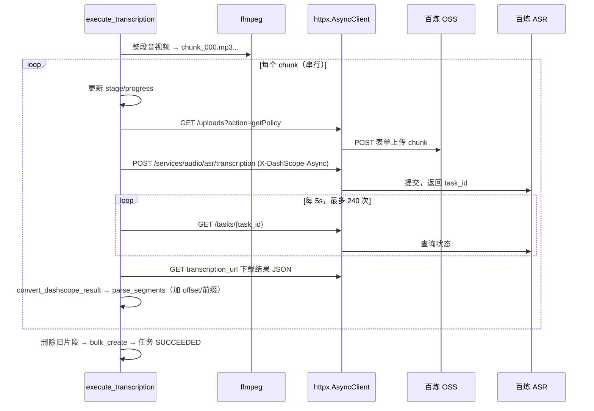
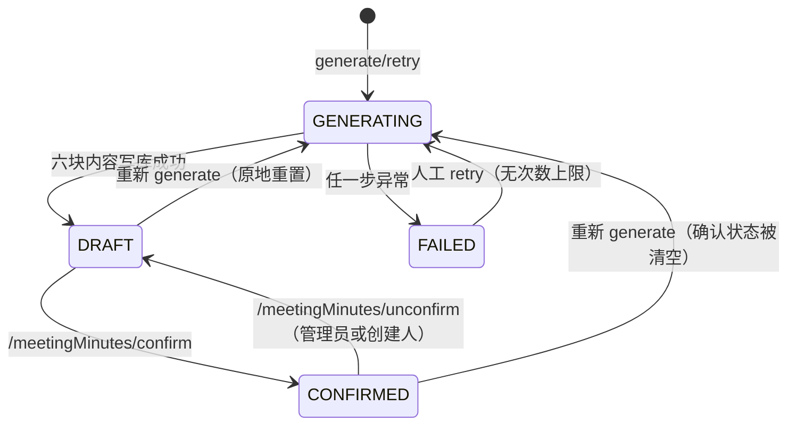
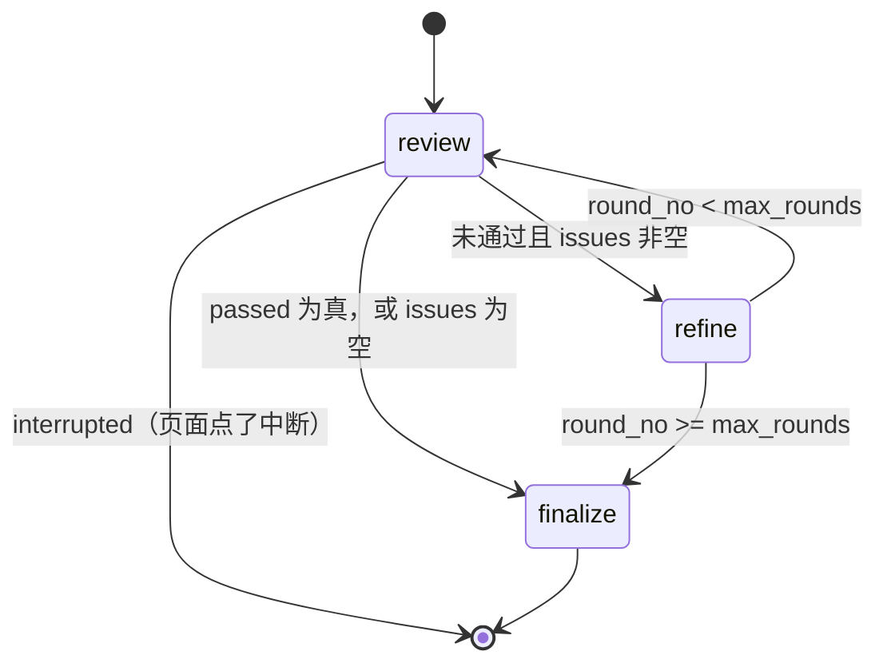
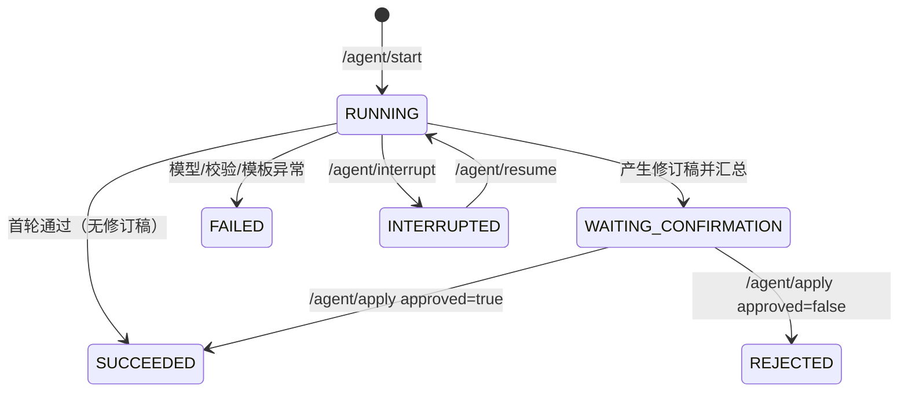
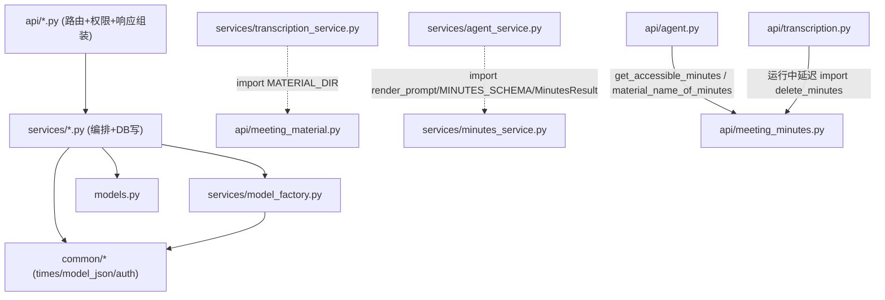

# AI 主链路调研：转写 → 纪要 → Agent 自检 → 人工确认 → 可观测

> **调研对象**：`ai_meeting/fastapi-app`（FastAPI + Tortoise ORM + LangChain/LangGraph + MySQL）与数据库脚本 `ai_meeting.sql`。
> **调研方式**：只读静态分析（read / grep / glob）。本次调研**未启动服务、未运行测试、未真实调用任何外部模型接口**，所有结论均来自源码与建库脚本。
> **行号约定**：路径相对项目根；`path:line` / `path:line-line` 为当前工作树行号。
> **证据等级**：**直接** = 代码字面可直接证明；**支持性** = 有测试/配置/种子数据旁证；**推断** = 由代码路径推导但未执行验证；**未知** = 需运行或外部资料才能确认。
> **原则**：注释极详尽但可能与代码不一致，本报告一律以代码行为为准；绝对化判断统一在 §11.1 复核。

## 0. 覆盖对照

| 任务问题 | 对应章节 |
|---|---|
| ① 三类异步任务调度/并发/恢复 | §2 |
| ② 转写链路（送模、分片、进度、重试、超时） | §3 |
| ③ 说话人识别真实算法与依赖 | §4 |
| ④ 纪要生成（分块、Prompt、JSON 容错、失败、幂等） | §5 |
| ⑤ LangGraph 图结构与状态落库 | §6 |
| ⑥ 人工确认/应用/reject 语义 | §7 |
| ⑦ ai_call_log 埋点与统计口径 | §8 |
| ⑧ Service 耦合与重复代码 | §9 |
| 端到端函数级调用序列 | §10 |
| 绝对判断复核、未知项、注释漂移 | §11 |

---

## 1. 全景：一条录音到最终纪要经过什么

```mermaid
flowchart LR
  U["上传资料<br/>meeting_material(AUDIO/VIDEO)"] --> T["transcription_task<br/>PENDING"]
  T -->|"schedule_transcription<br/>asyncio.create_task"| W["execute_transcription<br/>信号量(2)"]
  W --> F["ffmpeg 切 1200s 分片"]
  F --> D["百炼：OSS 上传→异步 ASR→轮询"]
  D --> S["transcript_segment<br/>时间轴+说话人标签"]
  S --> M["meeting_minutes<br/>GENERATING"]
  M -->|"schedule_minutes<br/>asyncio.create_task"| G["execute_minutes<br/>分块提取+合并<br/>信号量(2)"]
  G --> R["meeting_minutes DRAFT"]
  R -->|"POST /agent/start"| A["agent_run RUNNING<br/>无信号量"]
  A --> LG["LangGraph 反思环<br/>review→refine→review→…→finalize"]
  LG -->|首轮即通过| OK["agent_run SUCCEEDED<br/>纪要未被改动"]
  LG -->|产生修订稿| Q["WAITING_CONFIRMATION"]
  Q -->|"PUT /agent/apply approved=true"| R2["覆盖 meeting_minutes 六字段<br/>纪要仍为 DRAFT"]
  Q -->|"PUT /agent/apply approved=false"| X["agent_run REJECTED<br/>纪要不动"]
  R2 --> C["PUT /meetingMinutes/confirm<br/>CONFIRMED"]
  W -.-> L[("ai_call_log")]
  G -.-> L
  A -.-> L
```



关键事实速览（详见后文）：

- 三类异步任务都是**进程内 `asyncio.create_task` + 内存字典去重**，没有 MQ/任务表/独立 worker；进程重启只能靠 `lifespan` 里的三个 `recover_*` 兜底（**直接**：`ai_meeting/fastapi-app/main.py:17-28`、三个 service 的 `schedule_*`/`recover_*`）。
- 转写与纪要有 `Semaphore(2)`，**自检运行没有任何并发信号量**（**直接**：`services/transcription_service.py:26-31`、`services/minutes_service.py:78-83`；`services/agent_service.py` 全文无 `Semaphore`）。
- 转写是**串行分片**：1200 秒一片、逐片上传/提交/轮询，单片轮询硬上限 240×5s=1200s（**直接**：`services/transcription_service.py:21、124-126、219-252、445-461`）。
- 说话人"能区分"来自百炼 `diarization_enabled=True`，但标签按**分片**加前缀，跨片同一人无法自动合并；项目内的 `speaker_service` 只是"标签→参会人"的 LLM 建议，不做声纹识别（**直接**：`services/transcription_service.py:192-195、377`、`services/speaker_service.py:71-129`）。
- 纪要生成是 map-reduce：12000 字符一段、段内提取、多段再合并；全部成功才落库，任何一段失败整份 `FAILED`（**直接**：`services/minutes_service.py:11、105-127、130-175`）。
- LangGraph 只有 3 个节点：`review`、`refine`、`finalize`；循环边是 `refine→review`，轮数上限只在 `refine` 之后检查（**直接**：`services/agent_graph.py:102-131`）。
- 修订稿**从不自动写回**纪要，必须人工 `apply`；`apply` 只覆盖六个内容字段，不改纪要状态（**直接**：`services/agent_service.py:341-351`、`api/agent.py:205-252`）。

---

## 2. ① 三类异步任务的调度方式、并发上限与重启恢复

### 2.1 调度模型：进程内协程 + 内存字典 + 信号量，无持久队列

三个 service 用同一套手写模式，各自维护：`_running_*: dict[int, asyncio.Task]`（去重）、懒创建的 `asyncio.Semaphore`（限流）、`schedule_*()`（`asyncio.create_task` 并登记）、`recover_*()`（启动时重排）。**证据（直接）**：

- 转写：`services/transcription_service.py:21-31`（常量/字典/信号量）、`:499-514`（`run_scheduled` + `schedule_transcription`）、`:517-527`（`recover_transcription_tasks`）。
- 纪要：`services/minutes_service.py:12-15、78-83`、`:178-200`。
- 自检：`services/agent_service.py:26、436-452、455-460`。
- 启动串行恢复：`main.py:17-28`，且恢复在 `yield` 之前 `await`，即**先恢复完再对外服务**。
- 依赖清单中没有任何任务队列/调度库（celery/redis/rq/apscheduler 均无）；`requirements.txt` 只有 FastAPI/Tortoise/LangChain/LangGraph/httpx 等（**直接**：`ai_meeting/fastapi-app/requirements.txt`）。

推论（**推断**）：任务状态只存在于 `transcription_task.status` / `meeting_minutes.status` / `agent_run.status` 三列，进程内协程是唯一执行器；一旦协程丢失（进程死亡、取消、竞态），DB 状态就是唯一线索，而系统**没有周期性对账/watchdog**，只在启动时恢复一次。

### 2.2 三类任务对照表

| 维度 | ① 转写 | ② 纪要生成 | ③ 纪要自检 |
|---|---|---|---|
| 触发入口 | `POST /transcription/start/{material_id}`、`PUT /transcription/retry/{id}`、已存在任务重排 | `POST /meetingMinutes/generate/{task_id}`、`PUT /meetingMinutes/retry/{id}` | `POST /agent/start`、`PUT /agent/resume/{id}` |
| 入口证据 | `api/transcription.py:183-236、239-271` | `api/meeting_minutes.py:95-130、153-166` | `api/agent.py:131-166、267-278` |
| 调度函数 | `schedule_transcription` → `asyncio.create_task(run_scheduled)` | `schedule_minutes` → `asyncio.create_task(run_scheduled)` | `schedule_agent_run` → `asyncio.create_task(execute_agent_run)` |
| 调度证据 | `services/transcription_service.py:505-514` | `services/minutes_service.py:184-193` | `services/agent_service.py:436-444` |
| 去重方式 | `_running_tasks[id]` 未完成则跳过 | `_running_minutes[id]` 同上 | `_running_agents[id]` 同上 |
| 并发上限 | **2**（信号量包住整个 `execute_transcription`） | **2**（信号量包住整个 `execute_minutes`） | **无上限**（无信号量；仅"同一纪要只允许一个 RUNNING/WAITING"） |
| 并发证据 | `transcription_service.py:26-31、499-502` | `minutes_service.py:78-83、178-181` | `agent_service.py` 无 Semaphore；`api/agent.py:139-143` 只按纪要去重 |
| 任务内是否并行 | 否，分片 `for` 串行 | 否，块 `for` 串行，合并串行 | 否，图节点串行 |
| 状态机 | `PENDING→PROCESSING→SUCCEEDED/FAILED` | `GENERATING→DRAFT/FAILED` | `RUNNING→SUCCEEDED / WAITING_CONFIRMATION / REJECTED / FAILED / INTERRUPTED` |
| 状态证据 | `models.py:181-201`、`ai_meeting.sql:482` | `models.py:311-334`、`sql:239` | `models.py:360-388`、`sql:31` |
| 启动恢复 | `PROCESSING→PENDING`，再把**所有 PENDING** 重排 | 只把 `GENERATING` 重排，不重置任何字段 | 只把 `RUNNING` 重排，执行前把遗留 `RUNNING` 步骤记失败 |
| 恢复证据 | `transcription_service.py:517-527` | `minutes_service.py:196-200` | `agent_service.py:455-460、366-368` |
| 失败落点 | `FAILED` + `stage=转写失败` + `error_message[:2000]` + `finished_at` | `FAILED` + `stage=纪要生成失败` + `error_message[:2000]` | `FAILED` + `stage=自检失败` + `error_message[:2000]` + `finished_at` |
| 失败证据 | `transcription_service.py:489-496` | `minutes_service.py:173-175` | `agent_service.py:426-433` |
| 自动重试 | **无**；FAILED 只能人工 retry | **无**；人工 retry 无次数上限 | **无**；FAILED **不能** resume（resume 只接受 INTERRUPTED），只能新发起一次运行 |
| 重试上限 | `retry_count>=max_retry`（默认 3）时拒绝；计数只在人工 retry 里 +1 | 表里没有重试计数字段，人工可无限重试 | 无重试概念 |
| 重试证据 | `models.py:187-190`、`api/transcription.py:244-270` | `models.py:302-339`、`api/meeting_minutes.py:153-166` | `api/agent.py:270-271` |

**补充（直接）**：

- 转写/纪要/自检的 `schedule_*` 都是"已有未完成任务就 return"，因此**同一个 id 不会因重复点击而并发执行**；但入口层的状态检查本身并非原子（见 §5.6、§6.6）。
- 转写重试会**重新读取当前启用的转写模型配置**并写回任务（`api/transcription.py:249-259`）；纪要重试**不会**刷新模型配置（直接沿用生成时存的 `model_config_id`，`api/meeting_minutes.py:162-165`）。
- 自检 `interrupt` 的语义是"先改库为 INTERRUPTED，再 cancel 协程"（`api/agent.py:254-265`），与其他两类"没有取消接口"形成对比。

### 2.3 启动恢复的具体行为与失败后果

`lifespan` 顺序：转写 → 纪要 → 自检，三次 `await` 都无 try/except（**直接**：`main.py:23-28`）。因此：

1. **任一次恢复中的 DB 异常会向上抛，导致应用启动失败**（应用不会带着半恢复状态对外服务）。**推断**：代码无保护，Tortoise 查询异常即传播。
2. 恢复只处理"上次进程死亡时正在跑"的状态，**不会处理 FAILED**；所以"重启恢复"不等于"失败重试"（**直接**：三个 `recover_*` 的过滤条件）。
3. 转写恢复会把 `PROCESSING` 无条件改回 `PENDING` 并重排；**不重置** `retry_count`、不清理临时文件（临时文件本来就在 `TemporaryDirectory` 里，进程死亡后随系统清理）（**直接**：`transcription_service.py:517-527、432`）。
   - 意味着：一个"每次执行必败"的转写任务，会在**每次重启后再自动跑一次**，但失败后仍是 FAILED，不会形成无限循环（同一进程内无对账）。
4. 纪要恢复不做任何状态重置，`execute_minutes` 只处理 `GENERATING`（**直接**：`minutes_service.py:132-134`）；但 `execute_minutes` **从第一块重新生成**，之前的模型调用结果只保存在内存 `partials`（`minutes_service.py:144-165`），**没有 checkpoint**。重启即重跑、重复计费。
5. 自检恢复：`execute_agent_run` 先 `AgentRun.get_or_none`，非 `RUNNING` 直接退出；然后把所有遗留 `RUNNING` 的 `agent_step` 记成 FAILED（`agent_service.py:361-368`）；初始状态取 `run.current_round` 与 `run.revised_json`（`agent_service.py:406-418`），即**按轮恢复，不是按步恢复**（详见 §6.6）。

### 2.4 并发上限的真实含义

- 转写/纪要的信号量都是**整任务级**：`run_scheduled` 中 `async with get_semaphore(): await execute_*`（`transcription_service.py:499-502`、`minutes_service.py:178-181`）。即最多同时 2 个转写任务、2 个纪要任务在跑；排队任务由 `create_task` 建出后挂在信号量上。
- 自检没有信号量（`agent_service.py` 全文），只要有不同纪要发起运行就能并行；但每个运行内部同时最多 1 次模型调用（图串行）。
- 三类任务的限流互不相干，**没有全局 LLM 并发预算**（**直接**：三处信号量分属不同模块；`build_chat_model` 每次调用新建 `ChatOpenAI`，`services/model_factory.py:25-44、68`）。
- 结合上限可推导（**推断**）：最坏情况 LLM 并发 ≈ 2（纪要）×1 + N（自检运行）×1；转写不占 LLM 并发但占外部 ASR 并发（最多 2 个任务，各自串行）。

### 2.5 恢复的边界风险（需重点知道）

| 风险 | 说明 | 证据等级/证据 |
|---|---|---|
| 取消后状态卡住 | 转写/纪要只 `except Exception`，而 `asyncio.CancelledError` 在 Py3.8+ 是 `BaseException` 子类，不会被捕获。若进程在任务执行中收到取消/关闭，状态可能停在 `PROCESSING`/`GENERATING`，**只能等下次重启恢复**。 | **推断**：`transcription_service.py:489`、`minutes_service.py:173` 仅捕获 `Exception`；自检显式捕获 `CancelledError`（`agent_service.py:419-425`）可作对照 |
| 丢失唤醒 | `schedule_*` 的"已有未完成任务就跳过"是纯内存判断。极端时序下（旧协程未 done 时新状态已写好并调用 schedule）会跳过调度，且没有对账机制，任务可能长期停在 PENDING/GENERATING/RUNNING。典型场景：`interrupt` 后立即 `resume`——`cancel()` 只是发出取消信号，后台协程可能尚未结束，`resume` 里的 `schedule_agent_run` 会因 `_running_agents` 里旧任务未 done 而直接 return。 | **推断**：`api/agent.py:254-278` + `agent_service.py:436-444` |
| 多进程部署假设失效 | 字典、信号量都是进程内对象；若用多 uvicorn worker 部署，会重复执行、去重失效、`interrupt` 只能取消同进程任务、SSE 只能连到持有任务的 worker。代码里 `main.py:60` 是单进程 `uvicorn.run(...)`。 | **推断 + 直接**（部署命令不在仓库，**未知**） |
| 恢复期创建大量 Task | 恢复时对全部 PENDING 逐个 `create_task`，几千条排队任务会创建几千个协程对象（执行仍受信号量限制）。 | **推断**：`transcription_service.py:525-527` |

---

## 3. ② 转写链路：音频如何送给模型、分片、进度、重试、超时

### 3.1 前置条件与入口校验（直接）

- 只有 `AUDIO`/`VIDEO` 资料能转写；语言只接受 `zh/en/ja/ko`，空串表示自动识别（`api/transcription.py:191-197`）。
- 必须存在启用的 `TRANSCRIPTION` 模型且 `api_key` 非空；多条时取 **ID 最大**的一条（`api/transcription.py:198-204`；`enabled` 唯一性只在管理 API 里近似保证，`api/ai_model.py:95-97、141-145`）。
- 一份资料只允许一个任务：`transcription_task.material_id` 唯一（`models.py:173-174`、`sql:495`）。重复发起时：FAILED → 提示去重试；SUCCEEDED → 拒绝；PENDING/PROCESSING → 重新排队（`api/transcription.py:205-216`）。并发插入用 `IntegrityError` 兜底（`api/transcription.py:217-233`）。

### 3.2 音频→模型：本地 ffmpeg 分片 + 百炼 OSS + 异步 ASR + 轮询（直接）

代码不把音频塞进 LLM 请求体，而是走百炼"录音文件识别"协议，分三步（`services/transcription_service.py:289-341`）：

1. **ffmpeg 分片**（`prepare_audio_chunks`，`:34-88`）：
   - 参数：`-vn -ac 1 -ar 16000 -b:a 64k -f segment -segment_time 1200 -reset_timestamps 1`，输出 `chunk_%03d.mp3`。
   - 即**每片 20 分钟**（`CHUNK_SECONDS = 1200`，`:21`），单声道/16kHz/64kbps，每片时间戳从 0 重置（`:40-70`）。
   - 在 `asyncio.to_thread(subprocess.run, ...)` 中执行，注释说明是为规避 Windows Proactor/Selector 事件循环问题（`:72-79`）。
   - 无 ffmpeg / 无分段 → `RuntimeError`（`:36-37、86-87`）；分段按文件名排序（`:84`）。
2. **申请上传凭证并上传 OSS**（`upload_audio_to_dashscope`，`:129-173`）：
   - `GET {base_url}/uploads?action=getPolicy&model=...` 取 `upload_host/upload_dir/policy/signature/oss_access_key_id`；
   - 用表单 POST 到 OSS，对象键 `{upload_dir}/{chunk_name}`；成功后返回 `oss://{object_key}`。
3. **提交异步任务**（`submit_dashscope_transcription`，`:176-216`）：
   - Header：`X-DashScope-Async: enable`、`X-DashScope-OssResourceResolve: enable`；
   - Body：`model`、`input.file_urls=[file_url]`、`parameters.diarization_enabled=true`；`task.language` 非空时追加 `language_hints=[language]`（`:192-204`）；
   - POST `{base_url}/services/audio/asr/transcription`，取 `output.task_id`。
4. **轮询结果**（`wait_dashscope_result`，`:219-252`）：
   - 固定 `POLL_INTERVAL_SECONDS=5`，最多 `POLL_MAX_TIMES=240` 次（`:124-126`），即**单片最长约 1200s**；
   - `task_status=SUCCEEDED` → 取 `results[0].transcription_url` 再 GET 下载 JSON；`subtask_status=FAILED`/无 URL → 抛错；`FAILED` → 抛错；循环耗尽 → "转写任务超时未完成"。
   - HTTP 客户端 `timeout=config.timeout_seconds`（`AiModelConfig.timeout_seconds`，默认 600，范围 30~3600，见 `models.py:155-156`、`api/ai_model.py:83-84`），这是**单请求超时**，不是单片总超时。

**时序（直接）**：



### 3.3 结果转换与时间轴（直接）

- `convert_dashscope_result`（`:255-286`）：把 `transcripts[].text` 拼成整段文本、取 `content_duration_in_milliseconds` 的最大值折算秒；`sentences[]` 每句转成 `{start,end,speaker,text}`（毫秒→秒，`speaker_id` 缺失为 None）。
- `parse_segments`（`:344-401`）：
  - `segment_no` 跨片连续（`start_no + len(parsed)`）；
  - `start_ms/end_ms` 加本片累计偏移 `offset_ms`；
  - `speaker_label = f"{片号:02d}-{speaker_id 或 A}"`（`:377`）；
  - `original_text` 与 `content` 初始相同（便于后续只改 `content`）；
  - 本片时长优先用模型 `duration`，否则用最大 `end_ms` 兜底（`:384-386`）；
  - 模型只返回整段文本、没有 segments 时，把整段文本当**一个**片段（`:387-399`）。
- 偏移累计：`offset_ms += duration_ms`（`:461`），`total_duration_ms` 最终等于各片累加值（`:483`）——**不是**探测源文件的真实时长。

**风险（推断）**：偏移依赖每片"模型返回时长"的准确性。若某片模型时长小于真实片长（例如静音裁剪、识别截断），后续所有片段的绝对时间会整体前移，越往后漂移越大；代码没有 `ffprobe` 校验或重叠对齐。**直接**依据：`:384-386、461、483`。

### 3.4 进度/阶段/状态的写入点（直接）

| 时刻 | status | stage | progress | 证据 |
|---|---|---|---|---|
| 抢占任务 | `PENDING→PROCESSING`（条件 update，影响行数 0 则退出） | `正在准备音频` | 5 | `transcription_service.py:407-416` |
| 分片完成 | 不变 | `音频处理完成，共N个分段` | 20 | `:435-438` |
| 每片开始 | 不变 | `正在转写第i/N个分段` | `20 + int(i*70/N)` | `:448-451` |
| 全部成功 | `SUCCEEDED` | `转写完成` | 100 | `:478-488` |
| 任一步失败 | `FAILED` | `转写失败` | 保持当前值 | `:489-496` |

- 页面靠**前端 3 秒轮询列表接口**看进度（`ai_meeting/vue/src/views/manager/Transcription.vue:361-366`），转写没有 SSE（**直接**）。
- 写入 `transcript_segment` 前先 `delete` 旧片段（重试/恢复场景），再 `bulk_create`（`transcription_service.py:466-477`）。因为写入只发生在全部成功之后，失败/中断不会留下"半套片段"。

### 3.5 重试、失败态与超时（直接/推断）

- **片内不重试**：任一 chunk 抛异常 → 整个任务 `FAILED`，前 N 片的模型调用作废；重试从第 1 片重来（`transcription_service.py:445-496`）。**直接**。
- **自动重试不存在**：`recover_transcription_tasks` 只恢复 `PROCESSING/PENDING`，`FAILED` 不动（`:517-527`）。**直接**。
- **人工重试**：`PUT /transcription/retry/{task_id}`（`api/transcription.py:239-271`）：
  - 仅 FAILED 可重试；`retry_count >= max_retry` 拒绝（`max_retry` 默认 3，`models.py:189-190`）；
  - 条件 update `status="FAILED"` 防并发重复计数，`retry_count+1`、换最新启用的转写模型配置、清空错误与时间字段；
  - 由于检查是 `>=` 且先判断后 +1，**初始 1 次 + 最多 3 次重试 = 最多 4 次执行**（**推断**，由 `:247-248、256-268` 推导）。
- **超时**：
  - 单 HTTP 请求超时 `AiModelConfig.timeout_seconds`（`transcription_service.py:300-301`）；
  - 单片轮询上限 240×5s≈20 分钟（`:124-126、226-252`）；
  - 整任务无总超时：N 片串行，最坏 ≈ N×20 分钟 + 各请求超时（**推断**）。
- **错误信息**：`str(error)[:2000]` 写 `transcription_task.error_message`，页面详情展示（`api/transcription.py:111-112`）。

---

## 4. ③ 说话人识别：真实算法与输入依赖

### 4.1 声学层面的"分人"由外部 ASR 提供（直接）

- 提交转写时固定传 `parameters.diarization_enabled = True`（`services/transcription_service.py:192-195`）；
- 返回句子的 `speaker_id` 被转成 `speaker_label`：`f"{分片序号:02d}-{speaker_id 或 'A'}"`（`:255-286`、`:367-377`）；
- 因此**项目自身没有任何声纹/聚类算法**，说话人分离能力完全取决于百炼 paraformer 系列模型（种子配置 `paraformer-v2`，`ai_meeting.sql:139`）。厂商的精度与最大支持人数**未知**（外部事实，未验证）。

### 4.2 跨分片身份不连续（直接+推断）

- 标签带片号前缀：片 1 的 0 号说话人=`01-0`，片 2 的 0 号说话人=`02-0`（`:377`）。
- 即便两个片里是**同一个真人**，标签也不同；代码没有任何跨片合并/聚类逻辑（全仓库 grep 无 embedding/voiceprint/聚类相关实现）。
- 后果（**推断**）：长会议分片越多，标签越碎；人工匹配时必须对每个片段的标签分别匹配；`suggest_speakers` 也无法把"01-0 与 02-0 是同一个人"告诉用户。

### 4.3 `speaker_service` 的真实职责：LLM 猜"标签→参会人"，不是识别人（直接）

`suggest_speakers`（`services/speaker_service.py:71-129`）流程：

1. 取启用的 `SPEAKER` 用途模型（多条取 ID 最大），无 key 报错（`:73-76`）；
2. 取 `SPEAKER_MATCH` 模板且 `enabled=True`，停用则报错（`:77-80`）；
3. 取会议 + 参会人名单（`build_participants_text`，`:45-59`），名单行格式 `user_id=..｜姓名｜职位｜会议角色`；
4. 取该转写任务的**前 120 条片段**（`MAX_SEGMENTS=120`，`:6、62-68`），行格式 `[speaker_label] content`；
5. 一次 `invoke_json`，schema 为 `SPEAKER_SCHEMA`（`speaker_label/user_id/confidence/reason`，`:8-32`），`call_type="SPEAKER_MATCH"`、`biz_id=task_id`（`:100-102`）；
6. 过滤：标签必须真实存在于该任务（`distinct speaker_label`，`:104-107`），`user_id` 必须命中参会人（`0` 会被丢弃），否则丢掉该建议（`:108-128`）；返回带中文置信度文案。

**结论（直接）**：这一步输入只有"文本 + 名单"，不读取音频；输出只是建议，**不写库**；采纳要走 `PUT /transcription/matchSpeaker` 人工确认（`api/transcription.py:444-458` 的 docstring 与 `:415-441`）。
另外：`suggest_speakers(task_id, meeting_id, user_id)` 的 `user_id` 形参在函数体内**未被使用**（`services/speaker_service.py:71`；调用方 `api/transcription.py:455`），属于遗留参数。

### 4.4 人工匹配的写法（直接）

`match_speaker`（`api/transcription.py:415-441`）：

- 仅 `SUCCEEDED` 的转写可匹配（`:422-424`）；
- 标签必须存在（`TranscriptSegment.filter(task_id, speaker_label)`，`:426-431`）；
- 传 `user_id` 时必须为该会议参会人（`:432-437`）；
- `label_query.update(speaker_user_id=payload.user_id)` **整批写**同标签全部片段；`user_id=None` 即清空匹配（`:438-440`）。

### 4.5 下游谁在用说话人信息（直接）

| 使用方 | 用法 | 证据 |
|---|---|---|
| 转写详情页 | 汇总 speaker_label/匹配姓名/片段数 | `api/transcription.py:362-381` |
| 纪要分块提示词 | 有匹配用真实姓名，否则标签，再否则"未知说话人" | `services/minutes_service.py:105-127` |
| 纪要自检 | **不使用**说话人标签，只读 `transcription_task.full_text` | `services/agent_service.py:132-140` |
| 说话人建议 | 只用标签+文本 | `services/speaker_service.py:62-68` |

### 4.6 "是否真的能区分说话人"的准确回答

- 在**单个 20 分钟分片内**：能区分不同说话人（厂商 diarization 给出 `speaker_id`），这一点有种子数据旁证——同一任务的标签出现 `01-0`/`01-1`/`01-2`/`01-3`/`01-4`/`01-A`（`ai_meeting.sql:424-467`，**支持性**）。
- **跨分片**：不能自动认出是同一人（标签前缀不同，无合并逻辑）。
- **身份（谁是谁）**：不能自动确定；只能由 LLM 依据"点名句/自我介绍"给建议（只用前 120 条片段），再由人工确认。对于长会议，落在第 121 条之后的说话人标签不会出现在建议模型的输入里（**推断**：`speaker_service.py:6、62-68` 与 `:104-107` 对照——标签集合取自全量片段，但文本只喂前 120 条）。

---

## 5. ④ 纪要生成：分块、PromptTemplate、JSON 容错、失败与幂等

### 5.1 入口与前置校验（直接）

`POST /meetingMinutes/generate/{task_id}`（`api/meeting_minutes.py:95-130`）：

1. 转写任务必须 `SUCCEEDED`（`:98-100`）；
2. 按任务所属会议做权限校验（`:102`）；
3. 取启用的 `MINUTES` 模型（多条取 ID 最大），无 key 报错（`:104-106`）；
4. 两条模板 `MEETING_MINUTES_CHUNK`、`MEETING_MINUTES_MERGE` 必须启用（`assert_minutes_prompts_enabled`，`:56-62、108`）；
5. 同一会议**同一时刻只允许一份 `GENERATING`**（`:109-111`，非原子检查）；
6. 同一 `source_task_id` 已有纪要则**原地重置**（清六块内容、清确认人/确认时间、状态回 `GENERATING`），否则新建（`:113-127`）——幂等键是 `source_task_id`（`models.py:336-339`、`sql:255`）；
7. `schedule_minutes(minutes.id)` 后立即返回（`:128-130`）。

### 5.2 分块策略：按行拼、12000 字符、无重叠、map-reduce（直接）

`transcript_chunks`（`services/minutes_service.py:105-127`）：

- 取该任务全部 `transcript_segment`，按 `segment_no` 排序；
- 一次查出所有已匹配说话人的 `User` 做 id→name 映射（避免 N+1）；
- 每行格式：`[{start_ms//1000}s][{说话人或标签或'未知说话人'}] {content}`（`:114-117`）；
- 累加行长度，`current_size + len(line) > MAX_CHUNK_CHARS(12000)` 时封口开新块（`:119-123`）；
- **无重叠**、无 token 计数；单行本身超 12000 时仍会自成一块（因为判断条件是 `if current and ...`，`:119`），超大单行可能超出模型上下文（**推断**，取决于单条 segment 文本长度）。
- 块数 N 决定模型调用次数：N 次 `MINUTES_CHUNK` +（N>1 时）1 次 `MINUTES_MERGE`（`execute_minutes`，`:144-165`）。

### 5.3 PromptTemplate 的取用方式（直接）

- 模板按 `code` 从 `prompt_template` 表取，且 `enabled=True`（`minutes_service.py:139-140`）：
  - `MEETING_MINUTES_CHUNK`、`MEETING_MINUTES_MERGE`；
  - 自检另有 `MINUTES_REVIEW`、`MINUTES_REFINE`（`agent_service.py:221-223`）；
  - 说话人另有 `SPEAKER_MATCH`（`speaker_service.py:78`）。
- 变量替换是**手写字符串 replace**：`render_prompt(template, **vars)`（`minutes_service.py:86-91`），未传的变量原样保留；`{meeting_title}`、`{transcript}`、`{partials}` 等。
- 管理端保存时校验"必需变量"是否存在（`api/prompt_template.py:58-70`）：CHUNK 需要 `{meeting_title}{transcript}`，MERGE 需要 `{meeting_title}{partials}`，REVIEW 需要 `{meeting_title}{minutes_json}{transcript}`，REFINE 需要 `{meeting_title}{minutes_json}{issues}`，SPEAKER_MATCH 需要 `{meeting_title}{participants}{transcript}`。
- **无版本、无草稿**：更新是原地 `update`（`api/prompt_template.py:87`），改完立即影响下一次运行；历史运行只留有当时模型输出，不留当时的 prompt 文本（`ai_call_log` 不存 prompt），**无法回溯"某次结果用了哪版提示词"**（**直接**：`models.py:246-274` 无 prompt 字段；`api/prompt_template.py:87`）。
- 运行中模板被停用 → `PromptTemplate.get(enabled=True)` 抛异常 → 整份纪要 `FAILED`（**直接**：`minutes_service.py:139-140、173-175`）。

### 5.4 结构化输出与 JSON 解析容错（直接）

三层保障：

1. **服务端约束**：`ChatOpenAI.bind(response_format={"type":"json_schema","json_schema":{"name":...,"strict":True,"schema":schema}})`（`services/model_factory.py:39-44`）；`temperature=0`、`max_retries=0`（`:33-36`）。
2. **文本解析**：`parse_model_json` 用 `langchain_core.output_parsers.JsonOutputParser` 子类（`common/model_json.py:1-37`）：能剥离 ```json 围栏、忽略 JSON 之后的多余文字；解析结果必须是 `dict`，数组/非 JSON 直接抛错。
3. **业务校验**：纪要生成的每次调用都传 `validator=MinutesResult.model_validate`（`minutes_service.py:94-102`）；`MinutesResult` 要求 6 个字段齐全且类型正确（`summary/topics/viewpoints/decisions/pending_items/risks`，`MinutesResult` 与 `MINUTES_SCHEMA` 见 `:18-75`）；风险等级枚举 `LOW/MEDIUM/HIGH`。
   - 自检的 REFINE 调用在 `refine_round` 里再做一次 `MinutesResult.model_validate`（`agent_service.py:308-310`）；REVIEW 只依赖 `REVIEW_SCHEMA` + dict 解析（`:248-260`），不额外 pydantic 校验。
4. **提示词里再贴一次 schema 文本**：`build_schema_instruction(schema)` 追加到 HumanMessage 末尾（`model_factory.py:72-74`、`model_json.py:16-29`），与 response_format 双保险。

容错边界：**没有**"JSON 修复/二次问模型/降级取文本"逻辑；任何解析或校验失败都直接判本次调用失败（`model_factory.py:99-115`）。因此模型若拒不遵守 schema，整条链路失败（**直接**）。

### 5.5 失败与"部分成功"（直接）

- 所有分段结果只存内存 `partials`，**任一分段失败/合并失败 → 整份 `FAILED`**，不会把已成功的前几段落库（`minutes_service.py:144-175`）；重跑从头开始（重试接口不保留中间结果）。
- 失败信息：`status=FAILED`、`stage=纪要生成失败`、`error_message=str(error)[:2000]`（`:173-175`）。
- 重试：`PUT /meetingMinutes/retry/{minutes_id}`（`api/meeting_minutes.py:153-166`）：仅 FAILED、重查两条模板、原地改回 `GENERATING` 并重排；**没有重试次数上限、不刷新模型配置**。
- 进度：`10 + int(i*65/N)` → 合并时 80 → 完成 100（`:148、158、168-172`）；单块时直接从约 10 跳到 100。

### 5.6 幂等与并发（直接 + 推断）

| 点 | 行为 | 证据 |
|---|---|---|
| 幂等键 | `meeting_minutes.source_task_id` 唯一；一个转写任务只对应一份纪要，重新生成覆盖同一条 | `models.py:302-339`、`sql:234-258` |
| 生成入口 | 先 `get_or_none` 再 `create`；**没有捕获 `IntegrityError`**（转写入口有，`api/transcription.py:217-233`） | `api/meeting_minutes.py:113-118` |
| 并发双点 | 两个请求同时通过"不存在"判断 → 第二个 `create` 撞唯一索引 → 抛到全局异常处理器，前端看到"系统错误" | **推断**：`api/meeting_minutes.py:113-118` 无 try/except；`common/exception_handler.py:39-48` 兜底返回 500 |
| "同会议只生成一份" | 先 `exists()` 再建，非原子；并发下可能两份同时 GENERATING（但不同 source_task 允许） | `api/meeting_minutes.py:109-111` |
| 重置副作用 | 重新生成会清掉 `confirmed_by/confirmed_time`，已确认纪要被打回未确认 | `api/meeting_minutes.py:119-127` |
| 与自检的交叉 | `generate` **不检查**是否存在同纪要的 `WAITING_CONFIRMATION` 自检运行；用户可在等待确认期间重新生成，之后再 `apply` 会用旧修订稿覆盖新生成的纪要 | **推断**：`api/meeting_minutes.py:95-130` 未引用 `AgentRun`；`api/agent.py:205-252` 无版本/时间戳冲突校验 |

### 5.7 纪要状态机（直接）



`DRAFT` 唯一可编辑状态（`api/meeting_minutes.py:205-207`）；导出只允许 `DRAFT/CONFIRMED`（`:329-332`）。

---

## 6. ⑤ LangGraph 图结构、状态落库与循环上限

### 6.1 拓扑（代码精确版）

源码：`services/agent_graph.py`。图只做**调度**，不碰数据库、不直接调模型；审查/重写/汇总/中断检查四个异步动作由 `agent_service.execute_agent_run` 注入状态（模块 docstring `agent_graph.py:1-15`；注入点 `agent_service.py:406-418`）。



节点/边清单（**直接**：`agent_graph.py:102-131`）：

| 项 | 内容 | 证据 |
|---|---|---|
| 节点 | `review`、`refine`、`finalize`（共 3 个） | `:110-112` |
| 起始边 | `START → review` | `:115` |
| 条件边 1 | `review →` 由 `route_after_review` 决定，映射 `{finalize, refine, END}` | `:117-121`、`:84-92` |
| 条件边 2 | `refine →` 由 `route_after_refine` 决定，映射 `{review, finalize}` | `:123-127`、`:95-99` |
| 终止边 | `finalize → END` | `:129` |
| 循环边 | `refine → review`（唯一回边） | `:123-127` |
| 编译 | 每次运行都 `build_review_graph().ainvoke(...)`，即每次重新 compile | `agent_service.py:406` |

### 6.2 路由真值表（直接）

`route_after_review(state)`（`agent_graph.py:84-92`）：

| interrupted | passed | 去向 |
|---|---|---|
| True | 任意 | `END`（不写汇总） |
| False | True | `finalize` |
| False | False | `refine` |

其中 `passed` 由 `review_node` 计算：`bool(result["passed"]) or not issues`——模型说通过，**或**一条问题都没挑出来，都算通过（`agent_graph.py:59-66`；持久化侧同样逻辑 `agent_service.py:379-388`）。

`route_after_refine(state)`（`agent_graph.py:95-99`）：

| round_no vs max_rounds | 去向 |
|---|---|
| `round_no >= max_rounds` | `finalize`（**不再复审这一版**） |
| `round_no < max_rounds` | `review` |

### 6.3 终止条件与循环上限

**四种终止**（直接）：

1. `passed` 为真（模型判通过或 issues 为空）→ `finalize`；
2. `interrupted` 为真（`should_stop()` 在读运行记录时发现状态已不是 RUNNING）→ 直接 `END`，不写 FINAL 步骤；
3. 轮数上限：`refine` 完成后 `round_no >= max_rounds` → `finalize`；
4. 异常：`review/refine/finalize` 任一步抛异常 → `execute_agent_run` 捕获，整次运行 `FAILED`（`agent_service.py:426-433`）。

**轮数上限的双重兜底**：

- 业务上限：`RunPayload.max_rounds` 默认 2、允许 1~5（`api/agent.py:28-33、137-138`）；`agent_run.max_rounds` 默认 2（`models.py:367`、`sql:35`）。
- 框架上限：`recursion_limit(max_rounds) = max_rounds*2 + 2`（`agent_graph.py:134-136`），在 `ainvoke` 的 config 传入（`agent_service.py:417`）。
- 最坏步数核算：模型始终不通过时，节点序列 `review,refine` 重复 R 次再 `finalize` = `2R+1`；正常路径若第 k 轮通过（k≤R）则为 `2k`（k 次审查 + k-1 次重写 + finalize = 2k）。R=5 时 11 ≤ 12，R=1 时 3 ≤ 4（**直接 + 支持性**：测试 `tests/test_agent_graph.py:72-77` 覆盖 R=5 不通过场景且断言以 finalize 收尾）。
- **注意**：`route_after_review` 不检查 `max_rounds`，只有 `route_after_refine` 检查；正常流程依靠"review 之后若不通过必然 refine"间接保证，但**中断恢复路径可打破该保证**（见 §6.6）。

### 6.4 状态结构与"谁写状态"

`ReviewState`（`agent_graph.py:22-47`，`total=False`，节点返回部分字段由框架合并）：

| 字段 | 含义 | 写入方 |
|---|---|---|
| `working` | 当前待审版本（六字段 dict） | 初始 `agent_service.py:408`；`refine_node` 更新 |
| `issues` | 最近一轮问题清单 | `review_node` |
| `passed` / `score` | 最近一轮判定/得分 | `review_node` |
| `round_no` / `max_rounds` | 已完成/已审查轮次、上限 | 初始 `:409-410`；`review_node` +1 |
| `interrupted` | 中断标记 | `review_node`（`should_stop()` 为真时） |
| `review` / `refine` / `finalize` / `should_stop` | 注入的四个 async callable | `:411-415` |

- 状态只存在于 `ainvoke` 的一次调用内存里，**没有 LangGraph checkpointer**（全仓库 grep `checkpointer/thread_id/MemorySaver/...` 无结果，**直接**）。所谓"中断恢复"是 `execute_agent_run` 用 DB 字段重建初始状态 + 重新跑图。
- 初始 `working`：`run.revised_json or minutes_content(minutes)`（`agent_service.py:219`、`:406-418`）——即恢复时从"上次改到的稿子"继续。
- 初始 `round_no = run.current_round`（`:409-411`）。

### 6.5 `agent_run` / `agent_step` 落库时序（直接）

| 动作 | 数据库写入 | 证据 |
|---|---|---|
| 建运行 | `AgentRun.create(status=RUNNING, max_rounds=...)`，同时生成 `run_no=AGR+hex` | `api/agent.py:152-163` |
| 每次审查 | `review_round` → `open_step(REVIEW)`：`AgentStep.create(step_no=count+1, round_no, step_type, decision_summary)`，并 `AgentRun.update(stage=decision, progress=min(95, step_no*100/(2R+1)))` | `agent_service.py:236-245`、`168-188` |
| 审查成功 | `close_step`：step `SUCCEEDED`、`observation_summary=conclusion+问题行`、`payload_json={passed,score,issues}`、`elapsed_ms`、`finish_time`；随后 `do_review` 更新 run 的 `current_round/passed/score/issue_count/review_json` | `:266-272`、`:191-201`、`:375-389` |
| 审查失败 | `fail_step`：step `FAILED` + error + finish_time，异常继续上抛 | `:274-277`、`:204-211` |
| 每次重写 | `open_step(REFINE)`（decision 形如 `第r轮：按 k 条问题重写`） | `:280-291` |
| 重写成功 | `MinutesResult.model_validate` → `close_step(payload=新纪要)` → `do_refine` 更新 run.`revised_json` | `:309-312`、`:391-395` |
| 汇总 | `open_step(FINAL)` → `close_step(final 结论)` → 无修订稿：run `SUCCEEDED/progress=100/final_result/finished_at`；有修订稿：run `WAITING_CONFIRMATION/progress=100/final_result/finished_at` | `:333-351` |
| 中断 | API 先 `AgentRun.update(status=INTERRUPTED, stage=已中断)` 再 `cancel`；协程 `CancelledError` 分支把 `RUNNING` 步骤改 `FAILED（运行已中断，本步未完成）` | `api/agent.py:254-265`、`agent_service.py:419-425` |
| 恢复 | `resume` 改回 `RUNNING` 并重排；执行前把遗留 `RUNNING` 步骤改 `FAILED（上次执行被打断，本步未完成）` | `api/agent.py:267-278`、`agent_service.py:365-368` |

细节（**直接**）：

- `step_no = 该 run 现有 step 数 + 1`，靠 `(run_id, step_no)` 唯一索引防撞（`agent_service.py:174`；`models.py:418-421`；`sql:79`）。恢复时遗留的 RUNNING 步骤仍在表里，所以新步骤号会"接着排"，不会重启编号。
- `round_no=0` 只用于中断/异常场景（`AgentStep.round_no` 默认 0）；FINAL 步骤的 `round_no=run.current_round`（`agent_service.py:337`）。
- 进度公式 `min(95, step_no*100/(2R+1))`，最后 `finalize_run` 置 100（`:176-180`、`:343-350`）。
- `agent_run` 无 checkpoint/版本列；`review_json` 只保留**最后一轮** issues，前几轮只在 `agent_step.payload_json` 里（`agent_service.py:386-387` 注释与代码一致）。

### 6.6 中断/恢复的真实语义与边界缺陷

**恢复粒度 = 轮**（直接）：

- `execute_agent_run` 的初始状态只有 `round_no=run.current_round` 和 `working=run.revised_json or 纪要内容`；不恢复"上一次未完成的那一步"，也不恢复 `issues`（`agent_service.py:406-418`）。
- 因此：**中断发生在 refine 模型调用中途**时，`revised_json` 未写入，`current_round` 仍是上一轮；恢复后会直接进入 `review(round_no+1)` 审查**未改动的旧稿**，上一轮的问题清单（`review_json`）不会被带入重写。**推断**（由 `:391-395` 与 `:406-411` 推导）。

**边界缺陷 A：恢复后可能超过 `max_rounds` 多审查一轮**（推断）：

- 场景：`max_rounds=2`，第 2 轮审查已结束，`do_review` 已把 `current_round=2` 写库，但在进入 `refine`/`finalize` 之前被中断（`cancel` 恰好落在下一个 await）。
- 恢复：`round_no=2` → `review_node` 先 `+1` 得 3 → 审查第 3 轮；`route_after_review` 不检查上限（`agent_graph.py:84-92`），只有 `route_after_refine` 检查（`:95-99`）。结果是一次运行出现 `current_round=3 > max_rounds=2`。
- 证据：`agent_graph.py:56`（`round_no = state["round_no"]+1`，无上限保护）、`:95-99`；`agent_service.py:409-411`。

**边界缺陷 B：`finalize_run` 不校验运行状态**（推断）：

- `finalize_run` 直接重读 run，然后无条件把状态改成 `SUCCEEDED`/`WAITING_CONFIRMATION`（`agent_service.py:333-351`）。若 `interrupt` 的取消恰好发生在路由到 finalize 之后、写库之前，可能把已置为 `INTERRUPTED` 的运行覆盖回终态；`should_stop` 只在 `review` 开头检查（`agent_graph.py:52-54`），refine/finalize 前没有二次检查。**推断**。

**边界缺陷 C：`interrupt`/`resume` 的内存态竞态**：见 §2.5"丢失唤醒"。

**边界缺陷 D：`resume` 只接受 INTERRUPTED**（`api/agent.py:270-271`）：`FAILED` 的运行不能续跑，只能在满足"无 RUNNING/WAITING 运行"时新发起一次（`api/agent.py:139-143`）。

### 6.7 自检提示词与结构（直接）

- 审查模板 `MINUTES_REVIEW`：变量 `{meeting_title}{transcript}{minutes_json}`；输入转写是 `transcription_task.full_text` **截断到前 20000 字符**，超长时追加"只截取前半部分"提示（`agent_service.py:21、132-140`、`:221-233`）。
- 重写模板 `MINUTES_REFINE`：变量 `{meeting_title}{minutes_json}{issues}`；issues 用 `issue_line` 拼成"决策第1条｜没有明确负责人：… → 建议：…"的行（`agent_service.py:143-152、297-303`）。
- 审查输出 schema：`passed/score(0-100)/issues[{field∈6 字段,index,issue_type∈6 枚举,detail,suggestion}]/conclusion`（`agent_service.py:31-73`）；重写输出用 `MINUTES_SCHEMA`（与纪要生成同一套，`agent_service.py:224-226`）。
- 自检**不修改** `meeting_minutes`：`agent_service.py` 全文没有对 `MeetingMinutes` 的 update；`review_round/refine_round` 只写 `agent_step`，`do_review/do_refine` 只写 `agent_run`（**直接**，grep 佐证）。

---

## 7. ⑥ 人工确认 / 应用 / reject 的语义与写表

### 7.1 运行状态机（直接）



- 只有 `revised_json is None`（首轮就通过、内容一字未改）才直接 `SUCCEEDED`；只要产生过修订稿，一律停在 `WAITING_CONFIRMATION`（`agent_service.py:341-351`）。
- `WAITING_CONFIRMATION` 没有超时/自动处理；它会阻止同一纪要再发起新的自检（`api/agent.py:139-143`），直到人工 apply 或（管理员/发起人）删除运行（`api/agent.py:280-289`）。

### 7.2 apply 的两种语义（直接）

入口 `PUT /agent/apply/{run_id}`，body `{approved: bool, reason: str|null}`（`api/agent.py:28-40、205-252`）：

**前置校验**：

1. 运行必须 `WAITING_CONFIRMATION`，且 `revised_json` 非空（`:209-213`）；
2. 纪要必须存在（`:214-216`）；
3. 权限按**纪要创建人**判断（不是运行发起人）：管理员或 `minutes.created_by`（`:217-219`）。

**`approved=false`（放弃）**：

- 条件更新 `AgentRun.filter(id, status=WAITING_CONFIRMATION).update(status="REJECTED", reject_reason=(reason or "人工放弃本次修订").strip()[:500], applied_by, applied_time)`；影响行数 0 → "状态已经变化"（`:220-232`）；
- **纪要一个字不动**；修订稿保留在 `agent_run.revised_json` 可回看；`agent_step` 不写。

**`approved=true`（应用）**：

- 纪要为 `CONFIRMED` 时拒绝："纪要已确认归档，不能再覆盖，请先取消确认"（`:233-235`）；
- 先条件更新运行 `WAITING_CONFIRMATION→SUCCEEDED`（抢占，防止同一修订稿写两次），再 `MeetingMinutes.filter(id).update(summary, topics_json, viewpoints_json, decisions_json, pending_items_json, risks_json)` 六字段整体覆盖（`:236-251`）；
- **不改动** `meeting_minutes.status`（仍为 DRAFT）、不动 `confirmed_by/confirmed_time`、不写新行、不留旧版本（**直接**：`:243-251`）。

### 7.3 写表清单（直接）

| 操作 | 写入/删除的表与字段 |
|---|---|
| `/agent/start` | 插入 `agent_run`（RUNNING/run_no/minutes_id/meeting_id/user_id/model_config_id/max_rounds） |
| 自检过程 | 更新 `agent_run`（stage/progress/current_round/passed/score/issue_count/review_json/revised_json/final_result/finished_at/status）；插入/更新 `agent_step`（REVIEW/REFINE/FINAL） |
| `/agent/interrupt` | 更新 `agent_run.status=INTERRUPTED, stage=已中断`；协程侧把 RUNNING step 改 FAILED |
| `/agent/resume` | 更新 `agent_run.status=RUNNING, stage=等待继续, error_message=None, finished_at=None` |
| `/agent/apply approved=false` | 更新 `agent_run.status=REJECTED, reject_reason, applied_by, applied_time` |
| `/agent/apply approved=true` | 更新 `agent_run.status=SUCCEEDED, applied_by, applied_time`；更新 `meeting_minutes` 六字段 |
| `/agent/delete` | 先删 `agent_step` 再删 `agent_run`（要求非 RUNNING） |
| 会议级删除 | 管理员删除会议时级联删 `agent_step→agent_run→meeting_minutes→transcript_segment→transcription_task→meeting_material→meeting_participant→meeting`（`api/meeting.py:353-383`） |

### 7.4 语义边界与风险

- **apply 后仍需 `confirm`**：`apply` 只覆盖内容；纪要要变 `CONFIRMED` 必须再调 `PUT /meetingMinutes/confirm`（`api/meeting_minutes.py:217-226`）。**直接**。
- **人工编辑冲突**：用户在 `WAITING_CONFIRMATION` 期间编辑纪要（DRAFT 可改，`api/meeting_minutes.py:201-214`），apply 会用运行开始时构建的 `working`/审查后的 `revised_json` 覆盖这些编辑，**无 `update_time` 版本冲突校验**。**推断**：`api/agent.py:243-251` 无并发/版本检查。
- **重新生成冲突**：见 §5.6（`generate` 不检查 WAITING_CONFIRMATION 运行，可能被旧修订稿覆盖）。**推断**。
- **放弃语义**：`REJECTED` 后修订稿仍在 `revised_json`，但 `apply` 只接受 `WAITING_CONFIRMATION`，因此**不能再采纳**该修订稿；要采纳必须重跑自检。**直接**（`:209-211`）。
- **删除运行**：`INTERRUPTED/REJECTED/FAILED/SUCCEEDED` 都可删（只拦 RUNNING），删除会带走步骤记录与修订稿（`api/agent.py:280-289`）。**直接**。

---

## 8. ⑦ ai_call_log 埋点覆盖与统计口径

### 8.1 覆盖矩阵（直接）

写入点只有两处：`services/model_factory.invoke_json`（文本模型）与 `services/transcription_service.create_call_log`（转写）；全仓库无其他 `AiCallLog.create`（grep 佐证）。

| call_type | 触发点 | 每次粒度 | biz_id | 写日志函数 | 成功/失败都写? |
|---|---|---|---|---|---|
| `TRANSCRIPTION` | 每个音频分片一次 ASR（上传+提交+轮询聚合） | 1 分片 = 1 行 | `transcription_task.id` | `transcription_service.py:91-121、318-340` | 是（失败行 response_size 可能为 0） |
| `MINUTES_CHUNK` | 每个文本块一次提取 | 1 块 = 1 行 | `meeting_minutes.id` | `minutes_service.py:94-102、149-154` → `invoke_json` | 是 |
| `MINUTES_MERGE` | 多块时一次合并 | 1 次 = 1 行 | `meeting_minutes.id` | `minutes_service.py:157-165` | 是 |
| `AGENT_REVIEW` | 每轮审查 | 1 轮 = 1 行 | `agent_run.id` | `agent_service.py:248-260` → `invoke_json` | 是 |
| `AGENT_REFINE` | 每轮重写 | 1 轮 = 1 行 | `agent_run.id` | `agent_service.py:293-307` | 是 |
| `SPEAKER_MATCH` | 用户点"AI建议匹配" | 1 次 = 1 行 | `transcription_task.id` | `speaker_service.py:100-102` | 是 |

**未埋点的调用/动作（直接）**：

- ffmpeg 分片、OSS 凭证/上传、ASR 状态轮询（这些被合并进 `TRANSCRIPTION` 一行的耗时里，不能拆分观察）；
- `finalize` 步骤（无模型调用，自然不记）；
- 模板缺失/停用、模型配置不存在、DB 异常等**发生在模型调用之前**的失败（只在业务表 `error_message`，`ai_call_log` 无记录）；
- 人工操作（confirm/apply/reject）不写 AI 日志。

**字段口径（直接）**：

| 字段 | 转写 | 文本模型 |
|---|---|---|
| `request_id` | `"AIC"+uuid4().hex.upper()` | 同左（`model_factory.py:86`） |
| `request_size` | 分片 MP3 文件字节数（`transcription_service.py:297`） | `len((system+user).encode("utf-8"))`，**不含**随后追加的 schema 指令（`model_factory.py:64` vs `:72-74`） |
| `response_size` | `len(str(detail))`，**字符数不是 UTF-8 字节数**（`transcription_service.py:309`） | `len(text.encode("utf-8"))` 字节数（`model_factory.py:79`） |
| `usage_json` | 百炼结果 `detail["properties"]` 原样（`transcription_service.py:326`） | LangChain `message.usage_metadata`（`model_factory.py:96`） |
| `elapsed_ms` | 上传→提交→轮询→下载→转换 的总耗时（`transcription_service.py:295、316`） | 调用+解析+校验 的总耗时（`model_factory.py:62、94`） |
| 失败日志 | 有；`error_message` 截断 2000 | 有；`error_message` 截断 2000，并把异常包装为 `"{label}调用失败：…"` 再抛（`model_factory.py:99-115`） |

**口径不一致/缺陷**：

1. 转写 `response_size` 是字符数，文本模型是字节数——同名指标跨调用类型不可直接比较（**直接**：上表两处代码）。
2. 文本模型的 `request_size` 不包含 schema 指令文本，比真实请求体偏小（**直接**：`model_factory.py:64` 先算，`:72-74` 才拼 schema）。
3. 失败调用**不记录 usage**：即使模型已返回文本、只是 JSON 解析/校验失败（`response_size` 已赋值），except 分支也只写 error 不写 `usage_json`（**直接**：`model_factory.py:79-80、99-114`）。
4. schema/validator 失败被记为 `status=FAILED`，与 HTTP/模型层失败混在同一"调用失败率"里；看板无法区分"模型没调通"和"模型返回了但不合结构"（**直接**：`model_factory.py:82-84、99-114`）。
5. `elapsed_ms` 的物理含义在不同 call_type 间差异巨大（转写含分钟级轮询），`average_elapsed_ms` 跨类型求和没有业务意义；按 `call_type`/模型筛选后才可解释（**直接**：`observability_service.py:135-166`）。
6. 没有记录 prompt 模板 id/版本、没有父链路 trace id（`request_id` 独立随机），无法把一次纪要生成的多块调用串起来（只能靠 `biz_id` 分组）（**直接**：`models.py:246-274` 无相关列）。

### 8.2 观测页的统计口径（直接）

入口只有 `GET /observability/overview`（`api/observability.py:11-23`），一次返回全部聚合结果（`observability_service.build_observability:80-249`）：

- **范围**：日期默认最近 30 天、最大 366 天；结束日包含当天（右边界取次日零点，左闭右开）（`:17-34`）。
- **权限**：管理员看全量；员工先查自己名下的 `TranscriptionTask.id` / `MeetingMinutes.id` / `AgentRun.id` 三个集合，再在 Python 里过滤日志（`:56-77、93-96`）。即**员工看不到 `SPEAKER_MATCH` 日志**（`employee_can_see_log` 返回 False，`:76-77`）。
- **token**：`token_usage` 依次读 `input_tokens|prompt_tokens`、`output_tokens|completion_tokens`、`total_tokens|input+output`（`:37-53`）。
  - 文本模型：LangChain 归一化的 `usage_metadata` 命中。
  - 转写：`usage_json=百炼 properties`，代码不从中提取 token；properties 是否含上述键**未知**（外部返回结构未验证）；若不含，则转写日志的 token 记为 0（**推断**）。
- **卡片**（`:224-240`）：调用次数、失败次数、成功率、平均耗时、input/output/total tokens、自检运行数、自检成功率、平均自检耗时、步骤数、步骤失败率、平均轮次、产生修订稿的运行数、被放弃数。
- **图**：按天趋势（先铺零值再累计，`:114-132`）、调用类型分布（成功率/平均耗时/Token，`:150-158`）、模型排行（按 `model_config_id` 分组，`:160-166`）、步骤排行（REVIEW/REFINE/FINAL 的成功率与平均耗时，`:169-191`）、最近失败（AI 调用失败 + 自检运行失败合并取 10 条，`:205-215`）、状态分布（固定 6 状态，`:216、246`）。
- **未展示**：`request_size/response_size` 没有任何聚合/列表返回；原始日志明细页不存在（API 只有 overview）；因此尺寸字段目前是"只写不读"（**直接**：`build_observability` 返回结构 `:218-249` 无 size 字段）。
- **性能**：员工过滤在 Python 侧完成，需要先把日期范围内**全部**日志加载进内存（`:88-96`）；数据量大时是明显的扩展性隐患（**推断**，但由代码结构直接可得）。

---

## 9. ⑧ 各 Service 之间的耦合与重复代码

### 9.1 依赖方向（直接）



值得注意的耦合点：

1. **Service 反向依赖 API 层**：`services/transcription_service.py:12` 从 `api.meeting_material` import `MATERIAL_DIR`。分层上服务层应只依赖 models/common；当前实现使 `api.meeting_material` 成为"被服务引用的常量模块"。
2. **Service 之间互相引用**：`services/agent_service.py:17` 从 `minutes_service` import `MINUTES_SCHEMA, MinutesResult, render_prompt`；`api/agent.py:24` 又从 `minutes_service` import `material_name_of_minutes`。`minutes_service` 事实上承担了"纪要领域公共模块"的角色。
3. **API 之间互相调用**：`api/agent.py:9` → `api/meeting_minutes.get_accessible_minutes`；`api/transcription.py:287` 在函数内延迟 import `delete_minutes`（用于级联删除纪要）。
4. **观测服务编码了三类业务的主键语义**：`observability_service.py:56-77` 的 `call_type → 业务表 → biz_id` 映射是硬编码；新增一个 call_type 必须同步改这里，否则员工侧永远看不到（**直接**）。
5. **用户删除/会议删除的引用检查散落多处**：`api/user.py:90-115` 逐表检查 9 类引用；`api/meeting.py:353-383` 手工级联删除 7 张表。任何新表/新字段都要在这两处补，属于"隐式外键"带来的维护成本（**直接**）。
6. **`api/__init__.py:120-123` 自动 import 所有带 `router` 的模块**：路由注册是隐式的（新增文件自动生效），但也意味着模块导入顺序/副作用不受显式控制（**直接**）。

### 9.2 重复代码清单（直接）

| 重复项 | 位置 A | 位置 B | 说明 |
|---|---|---|---|
| `render_prompt` 字符串模板替换 | `minutes_service.py:86-91` | `speaker_service.py:37-42` | 两份实现逐行相同；`agent_service` 直接复用 minutes 的那份（`agent_service.py:17`） |
| 信号量懒加载 `get_semaphore` | `transcription_service.py:26-31` | `minutes_service.py:78-83` | 结构相同、容量都 2，但互不共享额度 |
| `_running_*` 字典 + `create_task` + `done_callback` 清理 | `transcription_service.py:505-514` | `minutes_service.py:184-193`、`agent_service.py:436-444` | 三次重复同一并发编排模式，没有通用 `TaskRunner` |
| `recover_*` | `transcription_service.py:517-527` | `minutes_service.py:196-200`、`agent_service.py:455-460` | 三次重复"查状态→重排"，但各自语义不同 |
| `AiCallLog.create(...)` 参数拼装 | `model_factory.py:85-97、103-114` | `transcription_service.py:102-121` | 两处拼装 10 个同名字段；新增字段需改两处 |
| "取启用的某用途模型（ID 最大）" | `api/transcription.py:199-201、250-252` | `api/meeting_minutes.py:104`、`api/agent.py:145`、`speaker_service.py:74` | 5 处相同查询；且 `enabled` 唯一性只在管理 API 里近似保证 |
| "两条 Prompt 是否启用"预检 | `api/meeting_minutes.py:56-62` | `api/agent.py:148-151` | 两个循环 + 不同错误文案 |
| 分段/全文两种转写文本源 | `minutes_service.transcript_chunks` 读 `transcript_segment`（`:105-127`） | `agent_service.transcript_excerpt` 读 `transcription_task.full_text`（`:132-140`） | 同一份数据两种取法；`full_text` 靠 `api/transcription.refresh_full_text`（`:174-180、411`）保持同步，属于"冗余派生字段" |
| 会话/权限辅助函数 | `api/transcription.get_accessible_task`、`api/meeting_minutes.get_accessible_minutes`、`api/agent.get_accessible_run`、`api/meeting.get_accessible_meeting` | 各 API 模块 | 结构一致但各自实现，权限口径（会议维度/纪要维度/运行维度）不一致是**有意设计**，但重复度高 |

### 9.3 架构层面的简评

- **优点**：模型调用统一收口在 `model_factory.invoke_json`（文本类）与 `transcription_service`（ASR），换模型只改 `ai_model_config`；prompt 全部外置到表；权限统一走会议维度；后台任务虽有重复但模式一致、容易理解。
- **主要技术债**：① 任务调度是"手写内存队列"，无持久化/对账/多 worker 支持；② 转写协议与厂商强绑定（`provider` 字段实际未参与分支，见 §11.3）；③ 观测数据模型不足以支撑排障（无 prompt 版本、无 trace、尺寸字段只写不读、失败 usage 丢失）；④ 跨模块隐式外键（级联删除/引用检查手写）。

---

## 10. 端到端函数级调用序列：一次录音 → 最终纪要

> 记号：`A → B` 表示 A 直接调用 B；`⇒` 表示跨异步边界（后台协程/外部 HTTP）。括号内为关键证据行号。

### 阶段 0：上传录音（非 AI，链路的输入）

1. `POST /meetingMaterial/upload/{meeting_id}` → `api.meeting_material.upload`（`:89-171`）
   → 权限 `get_accessible_meeting`（`api/meeting.py:104-112`）
   → 扩展名判型 `get_file_type`（`:31-42`，AUDIO/VIDEO/ATTACHMENT）
   → 流式写盘 + SHA-256 + 500MB 上限 + 同会议 hash 去重（`:107-161`）
   → `MeetingMaterial.create`（`:136-151`）。
   上传**不会**自动触发转写（全文件无 `schedule_transcription` 调用）。

### 阶段 1：发起转写 → 后台 ASR

2. `POST /transcription/start/{material_id}` → `api.transcription.start`（`:183-236`）
   → `get_accessible_material`（`api/meeting_material.py:80-86`）
   → `AiModelConfig.filter(model_type="TRANSCRIPTION", enabled=True).order_by("-id").first()`（`:198-204`）
   → `TranscriptionTask.create(PENDING)`（`:217-230`，`IntegrityError` 兜底 `:231-233`）
   → `schedule_transcription(task.id)`（`:235`，接口立即返回 `task_dict`）。
3. `schedule_transcription`（`services/transcription_service.py:505-514`）
   → 去重 `_running_tasks` → `asyncio.create_task(run_scheduled(task_id))` ⇒ **后台**。
4. `run_scheduled`（`:499-502`）→ `async with get_semaphore()`（容量 2，`:26-31`）→ `execute_transcription`。
5. `execute_transcription`（`:404-497`）
   → 条件 UPDATE `PENDING→PROCESSING`，`progress=5`（`:407-416`）
   → 读 `MeetingMaterial` / `AiModelConfig` / 磁盘文件（`:419-430`）
   → `prepare_audio_chunks`（`:34-88`）⇒ `asyncio.to_thread(subprocess.run, ffmpeg ...)`（`:74-79`）
   → 每片更新 stage/progress（`:448-451`）
   → `call_transcription_model`（`:289-341`）→ `httpx.AsyncClient` ⇒
     `upload_audio_to_dashscope`（`:129-173`）⇒ OSS
     `submit_dashscope_transcription`（`:176-216`）⇒ 百炼异步 ASR
     `wait_dashscope_result`（`:219-252`）⇒ 轮询 + 下载 JSON
     `convert_dashscope_result`（`:255-286`）
     → `create_call_log(...)` → `AiCallLog.create(call_type=TRANSCRIPTION, biz_id=task.id)`（`:318-340`）
   → `parse_segments`（`:344-401`）→ 累加 `all_segments / full_text_parts / offset_ms`
   → 循环结束后 `TranscriptSegment.delete+build_create`（`:466-477`）
   → `TranscriptionTask.update(SUCCEEDED, progress=100, total_duration_ms, full_text)`（`:478-488`）；
     任一步异常 → `FAILED`（`:489-496`）。

### 阶段 2（可选）：说话人建议与人工匹配

6. `POST /transcription/suggestSpeakers/{task_id}` → `api.transcription.suggest_speaker_match`（`:444-459`）
   → `speaker_service.suggest_speakers`（`:71-129`）
   → 取 `SPEAKER` 模型 + `SPEAKER_MATCH` 模板 + 参会人名单 + 前 120 条片段
   → `services.model_factory.invoke_json`（`:47-116`）
     → `build_chat_model` → `ChatOpenAI(...).bind(response_format=json_schema)`（`:25-44`）
     ⇒ `ainvoke`（外部 LLM）
     → `parse_model_json`（`common/model_json.py:32-37`）
     → `AiCallLog.create(call_type=SPEAKER_MATCH, biz_id=task_id)`（`:85-97 / 103-114`）
   → 服务层过滤非法标签/非参会人（`:104-128`）；**不写库**。
7. `PUT /transcription/matchSpeaker` → `api.transcription.match_speaker`（`:415-441`）
   → 校验标签存在、用户是参会人 → `TranscriptSegment.filter(...).update(speaker_user_id)`（整批）。

### 阶段 3：生成纪要 → map-reduce LLM

8. `POST /meetingMinutes/generate/{task_id}` → `api.meeting_minutes.generate`（`:95-130`）
   → 校验转写 SUCCEEDED / 会议权限 / `MINUTES` 模型 / 两条模板启用 / 同会议无 GENERATING
   → 已有纪要则原地重置，否则 `MeetingMinutes.create(GENERATING)`（`:113-127`）
   → `schedule_minutes(minutes.id)`（`:129`）。
9. `schedule_minutes`（`services/minutes_service.py:184-193`）→ `asyncio.create_task(run_scheduled)` ⇒ 后台
   → `run_scheduled`（`:178-181`）→ 信号量(2) → `execute_minutes`（`:130-175`）。
10. `execute_minutes`
    → `MeetingMinutes.get_or_none(status="GENERATING")`（`:132-134`）
    → `Meeting` / `AiModelConfig` / `PromptTemplate.get(code=..., enabled=True)` ×2（`:136-140`）
    → `transcript_chunks(source_task_id)`（`:105-127`）
    → 每块：更新 stage/progress（`:148`）→ `call_minutes_model`（`:94-102`）→ `invoke_json(..., "MINUTES_CHUNK", minutes.id, validator=MinutesResult.model_validate)`（`:98-102`）
    → 多块时：`json.dumps(partials)` → `call_minutes_model(..., "MINUTES_MERGE")`（`:157-165`）
    → `MinutesResult.model_dump()` → `MeetingMinutes.update(status=DRAFT, progress=100, 六字段)`（`:166-172`）
    → 异常 → `FAILED`（`:173-175`）。

### 阶段 4：Agent 自检 → LangGraph 反思环

11. `POST /agent/start` → `api.agent.start`（`:131-166`）
    → `get_accessible_minutes` → 纪要状态 ∈ {DRAFT, CONFIRMED}（`:134-136`）
    → `max_rounds` 1~5（`:137-138`）
    → 同纪要无 RUNNING/WAITING_CONFIRMATION 运行（`:139-143`）
    → `AGENT` 模型 + `MINUTES_REVIEW/MINUTES_REFINE` 模板（`:144-151`）
    → `AgentRun.create(RUNNING, run_no=AGR+hex)`（`:152-163`）
    → `schedule_agent_run(run.id)`（`:165`）。
12. `schedule_agent_run`（`services/agent_service.py:436-444`）→ `asyncio.create_task(execute_agent_run)` ⇒ 后台（**无信号量**）。
13. `execute_agent_run`（`:354-433`）
    → `AgentRun.get_or_none` + 状态必须 RUNNING（`:361-364`）
    → 遗留 RUNNING step → FAILED（`:365-368`）
    → 读 `AiModelConfig` / `Meeting` / `MeetingMinutes`（`:369-372`）
    → `build_minutes_context`（`:214-233`）：`transcript_excerpt(source_task_id)`（`:132-140`，20000 字符截断）+ 两个模板 + schema + `working=revised_json or minutes_content`
    → 定义闭包 `do_review`（`:375-389`）、`do_refine`（`:391-395`）、`should_stop`（`:397-400`）、`do_finalize`（`:402-403`）
    → `build_review_graph().ainvoke({...}, {"recursion_limit": 2R+2})`（`:406-418`）。
14. 图内循环（`services/agent_graph.py`）：
    - `review_node`（`:50-67`）→ `should_stop()` 读 DB；`round_no+=1`；`state["review"](working, round_no)`
      → `review_round`（`agent_service.py:236-277`）
        → `open_step(REVIEW)`：`AgentStep.create` + `AgentRun.update(stage,progress)`（`:168-188`）
        → `call_model` → `invoke_json(..., "AGENT_REVIEW", run.id)`（`:155-165、248-260`）⇒ 外部 LLM
        → `close_step`（step SUCCEEDED + payload）→ `do_review` 更新 run（`:375-389`）
    - `route_after_review`（`agent_graph.py:84-92`）：interrupted→END；passed→finalize；否则→refine
    - `refine_node`（`:70-74`）→ `state["refine"]` → `refine_round`（`agent_service.py:280-315`）
        → `open_step(REFINE)` → `call_model` → `invoke_json("AGENT_REFINE")` → `MinutesResult.model_validate` → `close_step`
        → `do_refine` 更新 `agent_run.revised_json`（`:391-395`）
    - `route_after_refine`（`agent_graph.py:95-99`）：`round_no>=max_rounds`→finalize，否则→review（回到上一步）
    - `finalize_node`（`:77-81`）→ `finalize_run`（`agent_service.py:333-351`）：`open_step(FINAL)` → `final_summary` → `close_step` → run 置 `SUCCEEDED`（无修订稿）或 `WAITING_CONFIRMATION`（有修订稿）。
15. 前端实时看到过程：`GET /agent/events/{run_id}` → SSE 生成器（`api/agent.py:291-320`）每 1s 查 `AgentRun` + `run_dict(..., with_steps=True)`，有变化才推；进入 5 种终态后关闭连接（`:297-312`）。

### 阶段 5：人工确认与应用

16. `PUT /agent/apply/{run_id} {"approved": true}` → `api.agent.apply`（`:205-252`）
    → 校验 WAITING_CONFIRMATION + revised_json + 纪要权限
    → 抢占 `AgentRun.update(SUCCEEDED, applied_by/applied_time)`（`:238-242`）
    → `MeetingMinutes.update(六字段)`（`:243-251`）
17. `PUT /meetingMinutes/confirm/{minutes_id}` → `api.meeting_minutes.confirm`（`:217-226`）
    → `DRAFT→CONFIRMED` + `confirmed_by/confirmed_time`。
18. 导出（可选）：`GET /meetingMinutes/export/{id}/{word|pdf}` → `export_file`（`:326-343`）→ `build_docx`/`build_pdf`（`:263-323`）。

### 阶段 6：观测

19. 各阶段模型调用已写 `ai_call_log`（见 §8.1）。
20. `GET /observability/overview?date_from&date_to&model_config_id` → `api.observability.overview`（`:11-23`）→ `build_observability`（`observability_service.py:80-249`）→ 聚合卡片/图/最近失败。

---

## 11. 复核、未知项与注释漂移

### 11.1 绝对判断复核表

| 曾容易写成的判断 | 复核结论 | 证据 |
|---|---|---|
| "所有模型调用都经过 `model_factory`" | **否**。文本类（纪要/自检/说话人）走 `invoke_json`；转写走 `httpx` 直连百炼 ASR，完全不经 `model_factory`。 | `model_factory.py:1-11`（docstring 明确）、`transcription_service.py:9、289-341` |
| "三类异步任务都有并发上限" | **否**。转写/纪要有 `Semaphore(2)`，自检运行**没有信号量**。 | `transcription_service.py:30`、`minutes_service.py:82`、`agent_service.py` 无 `Semaphore` |
| "`ai_call_log` 覆盖所有 AI 调用" | **否**。只覆盖 6 类模型调用；ffmpeg/OSS/轮询被合并，模板/配置类失败不埋点，人工操作不埋点。 | §8.1 矩阵 + `grep AiCallLog` 仅两处写入点 |
| "token 统计覆盖所有调用" | **否**。失败调用不记 usage；转写 usage 是厂商 `properties`，是否会映射成 token **未知**，很可能是 0。 | `model_factory.py:85-97、103-114`；`transcription_service.py:326`；`observability_service.py:37-53` |
| "一份纪要只有一份、不可变版本" | **是唯一行，但不是版本历史**。`source_task_id` 唯一，重新生成**原地覆盖**（含确认状态），没有多版本。 | `models.py:336-339`、`sql:255`、`api/meeting_minutes.py:113-127` |
| "说话人识别能自动区分并命名说话人" | **部分**。分片内有声学分离；跨片不合并；身份靠 LLM 建议 + 人工确认；建议只看前 120 条片段。 | §4.1-4.6 |
| "重启后三类任务都能续跑" | **部分**。转写/纪要**从头重跑**（纪要大改重算）；自检按轮重建（会丢未完成步）。 | §2.3、§6.6 |
| "人工确认后纪要变成已确认" | **否**。`/agent/apply` 只覆盖六个内容字段，纪要仍 `DRAFT`；要再调 `/meetingMinutes/confirm`。 | `api/agent.py:243-251`、`api/meeting_minutes.py:217-226` |
| "Agent 自检会自己把修订稿写回纪要" | **否**。`agent_service` 不写 `meeting_minutes`；唯一回写路径是 `/agent/apply`。 | §6.7、§7.2；`api/agent.py:205-252` |
| "FAILED 会自动重试/恢复" | **否**。三个 `recover_*` 都不处理 FAILED；转写需人工 retry（有上限），纪要需人工 retry（无上限），自检 FAILED 不能 resume。 | §2.2 表 |
| "一份资料可以重复发起多个转写任务" | **否**。`transcription_task.material_id` 唯一。 | `models.py:173-174`、`sql:495` |
| "同类模型配置可以启用多个、随机选一个" | **运行期可能多条**，代码取 **ID 最大**；管理 API 在启用时会把同类其他配置停用，属近似约束。 | `api/ai_model.py:95-97、141-145`；`api/transcription.py:199-201` 等 5 处 |
| "所有模板修改立即生效且可追溯" | 立即生效**是**，可追溯**否**。模板原地 update、无版本，`ai_call_log` 不存 prompt。 | `api/prompt_template.py:79-88`、`models.py:277-299`、`model_factory.py:85-97` |

### 11.2 未验证/未知项（需运行或外部资料）

1. **百炼 OpenAI 兼容模式是否接受 `response_format={"type":"json_schema","strict":true}`**：代码强依赖它；若厂商不支持，全部文本模型调用会失败。仓库内无运行记录/文档可证。**未知**（证据：`model_factory.py:39-44`）。
2. **百炼 ASR `properties` 的字段结构**：决定转写日志的 token 统计是否为 0。**未知**（`transcription_service.py:326`、`observability_service.py:37-53`）。
3. **`diarization_enabled` 的实际说话人上限/准确率**、以及 `speaker_id` 是否可能为字符串/跨片是否稳定。**未知**（`transcription_service.py:192-195、279、377`）。
4. **LangGraph 1.2.12 下 `add_conditional_edges` 的 `{END: END}` 映射行为**：有单测覆盖（`tests/test_agent_graph.py:49-89`），但本次未运行测试。**支持性**。
5. **生产部署是否单进程**：内存字典/信号量/SSE/中断都假设单进程；仓库只有开发启动命令 `uvicorn.run("main:app", host="localhost", reload=True, port=9090)`（`main.py:59-60`）。**未知**。
6. **`ChatOpenAI` 在 langchain-core 1.6.4 下 `message.text` / `message.usage_metadata` 的存在性**：按版本应为标准接口，未运行验证。**支持性**（`model_factory.py:77、96`；`requirements.txt` 固定版本）。
7. **历史数据一致性**：种子库 `ai_meeting.sql` 有 `transcription_task`/`transcript_segment`/`meeting` 等数据，但 `meeting_minutes`、`agent_run`、`agent_step`、`ai_call_log` 四张表**没有种子记录**（`sql:260-263、56-58、83-86、112-114` 均为空记录段）。因此"开箱即用"时观测页与自检页为空，需先跑链路。**直接**。

### 11.3 注释/文档与代码不一致处（以代码为准）

| 位置 | 注释说法 | 代码事实 |
|---|---|---|
| `api/ai_model.py:79-81` + `services/transcription_service.py` | 提供 `provider` 字段，注释称"转写走百炼协议、纪要等走 OpenAI 兼容" | 服务层**完全不读** `config.provider`（grep 无引用）；转写永远调百炼路径，文本永远走 `ChatOpenAI`。改 `provider` 不改变行为。**直接** |
| `models.py:253`、`sql:95` | `biz_id` 注释提到"索引、问答、发起用户ID" | 本代码库不存在索引/问答模块；实际只有 `TRANSCRIPTION`/`MINUTES_*`/`AGENT_*`/`SPEAKER_MATCH` 四类业务 id。**直接** |
| `models.py:337` 注释"AI会议纪要版本表" | 暗示多版本 | 实际 `source_task_id` 唯一且重新生成原地覆盖，**没有版本历史**。**直接** |
| `agent_graph.py:9` 注释"一轮等于审查一次 + 按问题改一版" | 与代码一致 | 但 `max_rounds=1` 时"改完不再复审"，`max_rounds=2` 时"改完一定复审"——取决于配置，注释的"默认两轮"来自 `api/agent.py:31-33`。**支持性** |
| `transcription_service.py:484` 注释"第14章纪要自检审查时读取它" | 自检确实读 `full_text` | 一致；但纪要生成读的是 `transcript_segment` 而非 `full_text`，两处口径不同（§9.2）。**直接** |
| `api/meeting_minutes.py:26-27` import `AgentRun, AgentStep` | — | 文件内**未使用**（死 import）。**直接** |
| `services/speaker_service.py:71` 形参 `user_id` | 调用方传入 `current_user.id`（`api/transcription.py:455`） | 函数体未使用该参数。**直接** |
| `tests/test_agent.py:67-71` 创建 `TranscriptionTask(task_no=...)` | — | 当前 `models.TranscriptionTask`（`models.py:168-207`）**没有 `task_no` 字段**，该用例按当前模型会因未知 kwargs 报错，说明测试未随模型演进同步（测试整体可信度需打折）。**直接** |
| `services/transcription_service.py:405-406` 注释"只有 PENDING 才能改成 PROCESSING" | 与代码一致 | 但启动恢复会把 `PROCESSING` 无条件改回 `PENDING`（`:520-523`），若多实例部署会抢占别的实例正在跑的任务。**推断** |

### 11.4 对阅读者的最小结论集

1. 这是"**单进程 + 内存任务表 + 人工兜底**"的工程实现：适合演示/单机部署，不适合多实例或高可靠生产。
2. 真正的 AI 能力边界：**转写=厂商 ASR（分片+说话人分离）**、**纪要=LLM map-reduce**、**自检=LLM 反思环（LangGraph 3 节点循环）**、**说话人身份=LLM 建议+人工**。
3. 全链路最容易出问题的三处：**外部模型协议兼容性（json_schema strict）**、**长音频分片的时长/说话人标签漂移**、**中断恢复的轮级语义与并发竞态**。
4. 可观测性只到"聚合看板"级别：能看调用量/失败率/token/耗时，**不能**定位到具体 prompt 版本或单次调用的输入输出。

---

*报告生成时间：2026-10-29；分析对象为当时工作树。*
